## Análise Exploratória dos Dados (EDA)

> Projeto: Previsão do tempo de entrega de pedidos — Olist
> Código: [`src/eda.py`](../src/eda.py) · Figuras e tabelas: [`docs/figures/03_eda/`](figures/03_eda/)

Este documento é o roteiro da parte "Análise Exploratória dos Dados" do trabalho.
Cada seção abaixo corresponde a um slide. Os números vêm da execução no dataset
real (`python src/eda.py`).

O enunciado pede **pelo menos 4 itens**; aqui são cobertos **os 5**.

---

## Visão geral

**Bullets:**
- A EDA é feita sobre a **base construída no Tópico 2**: 1 linha = 1 pedido
  entregue, **95.100 pedidos** e **27 features**, compras de **out/2016 a ago/2018**.
- Usamos as features **ainda na escala original** (antes de imputação,
  escalonamento e codificação), para que os gráficos sejam interpretáveis.
- A análise de outliers do alvo usa também a base **antes da limpeza**
  (96.470 pedidos), para mostrar exatamente o que foi cortado.
- A EDA olha a base inteira (treino + teste) só para **entender** os dados;
  nenhum hiperparâmetro ou decisão do modelo é ajustado com ela.

---

## 1. Estatísticas descritivas

**Variável alvo — tempo de entrega (dias):**

| Média | Mediana | Desvio padrão | Mín. | Q1 | Q3 | Máx. | Assimetria |
|---|---|---|---|---|---|---|---|
| 11,9 | 10,1 | 7,5 | 0,5 | 6,7 | 15,3 | 42,6 | 1,28 |

**Principais features numéricas:**

| Feature | Média | Mediana | Desvio | Máx. | Assimetria |
|---|---|---|---|---|---|
| Distância média vendedor→cliente (km) | 594 | 430 | 586 | 3.398 | 1,7 |
| Prazo estimado (dias) | 23,6 | 23,2 | 8,7 | 155 | 0,9 |
| Frete total (R$) | 22,7 | 17,1 | 21,5 | 1.795 | 12,5 |
| Preço total (R$) | 136,5 | 85,9 | 208,5 | 13.440 | 10,0 |
| Peso total (g) | 2.371 | 750 | 4.742 | 184.400 | 6,6 |
| Nº de itens | 1,14 | 1 | 0,54 | 21 | 7,6 |

Tabela completa (19 variáveis, com quartis e curtose):
[`tabelas/estatisticas_numericas.csv`](figures/03_eda/tabelas/estatisticas_numericas.csv).

**Tempo de entrega por região do cliente:**

| Região | Pedidos | Mediana (dias) | Média (dias) | Distância mediana (km) | % vendedor no mesmo estado |
|---|---|---|---|---|---|
| Sudeste | 65.504 | 8,6 | 10,3 | 328 | 50,5% |
| Sul | 13.667 | 12,1 | 13,6 | 623 | 9,2% |
| Centro-Oeste | 5.554 | 13,2 | 14,5 | 864 | 1,6% |
| Nordeste | 8.675 | 17,0 | 18,4 | 1.875 | 1,5% |
| Norte | 1.700 | 19,3 | 20,6 | 2.378 | 0,0% |

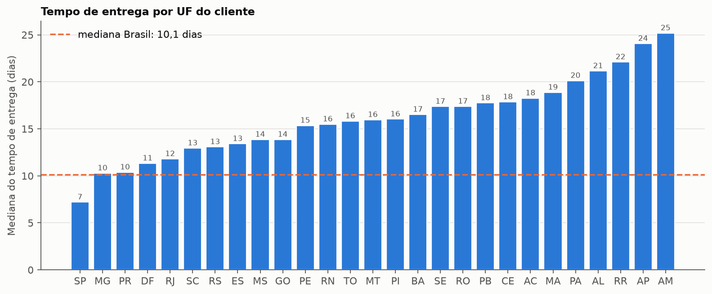

**Bullets:**
- Média > mediana → cauda à direita: a maioria chega em ~1 semana e meia, mas
  há entregas bem mais lentas.
- **SP: 7,2 dias** de mediana; **AM: 25,2 dias**, mais de **3× mais**.
- O tempo cresce junto com a distância até o vendedor e cai com a fração de
  pedidos do mesmo estado: **a geografia explica boa parte do problema**.

---

## 2. Distribuição das variáveis

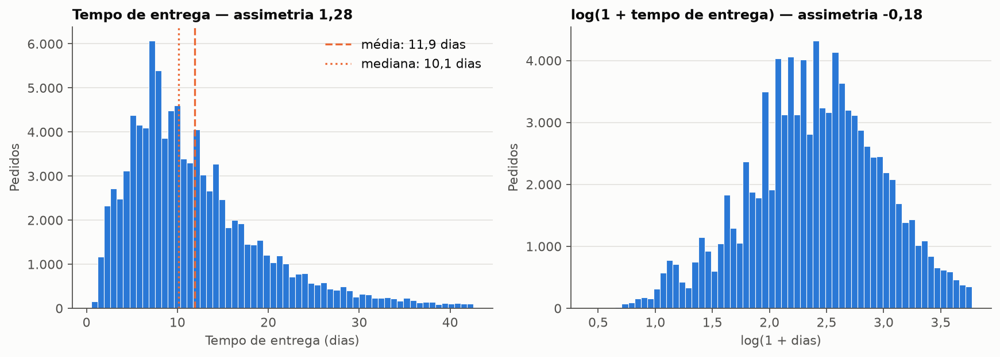

- **Alvo assimétrico** (assimetria 1,28). Em `log(1 + dias)` fica praticamente
  simétrico (−0,18) → **vale testar o modelo com o alvo em log no Tópico 4**.

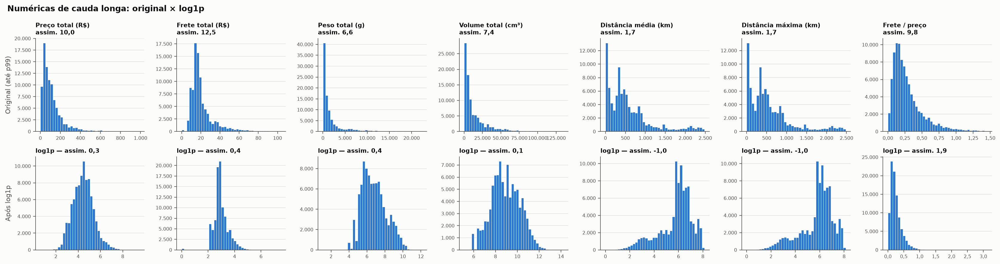

- Preço, frete, peso e volume têm assimetria entre 6 e 12; após `log1p` ficam
  entre 0,1 e 0,4 → **confirma a escolha de `log1p + StandardScaler` do Tópico 2**.
- Exceções: na **distância** o log1p "passa do ponto" (assimetria 1,7 → −1,0) e em
  **frete/preço** quase não muda (9,8 → 1,9, valores pequenos). Para elas,
  `RobustScaler`/`QuantileTransformer` seriam alternativas.

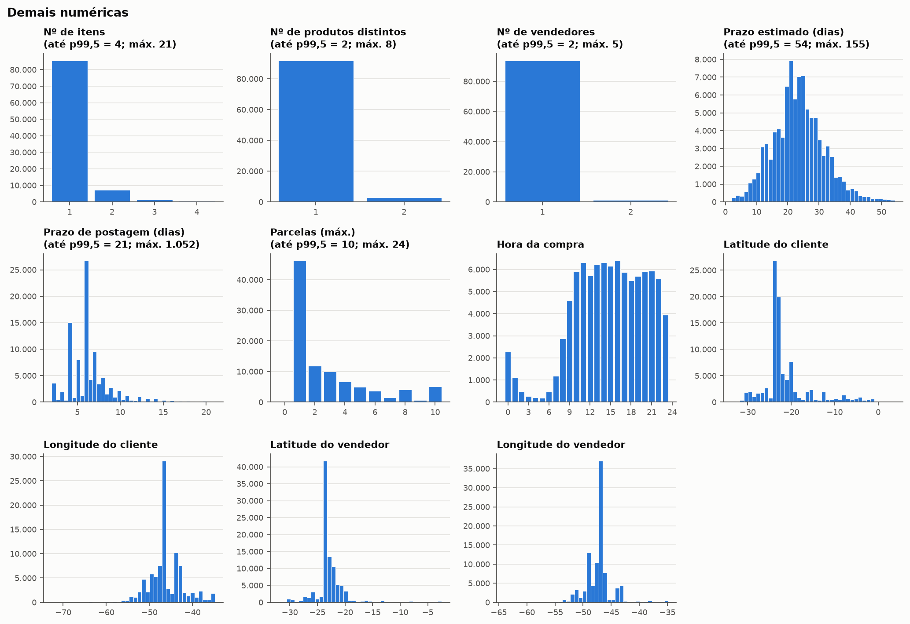

- **~90% dos pedidos têm 1 item**, 1 produto e 1 vendedor → essas contagens
  têm pouca variação.
- Prazo estimado concentrado entre 18 e 28 dias. Hora da compra concentrada
  entre 10h e 22h.

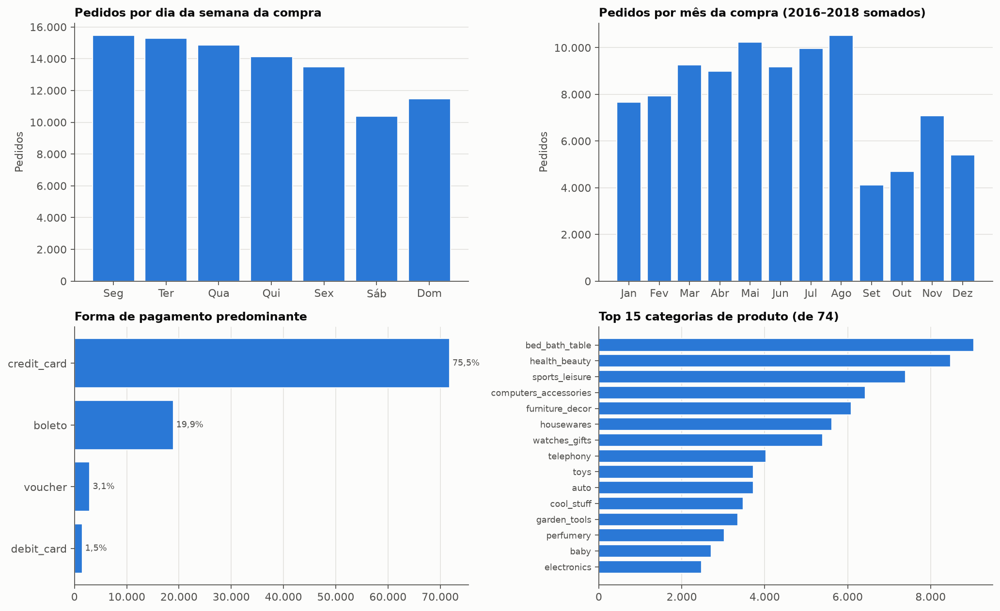

- **Cartão de crédito: 75,5%** dos pedidos; boleto 19,9%; voucher 3,1%; débito 1,5%.
- **74 categorias** de produto; a maior (`bed_bath_table`) tem só 9,5% → alta
  cardinalidade, justifica o `TargetEncoder` do Tópico 2.
- **Atenção:** setembro e outubro aparecem baixos porque a base começa em
  out/2016 (início fraco) e termina em ago/2018. **Não é sazonalidade.**

---

## 3. Identificação de outliers

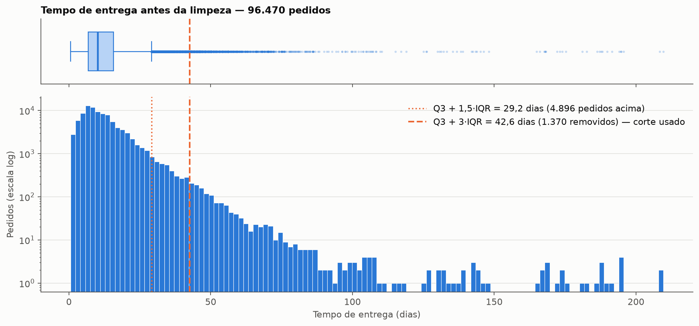

**Bullets:**
- Antes da limpeza, o alvo chega a **~210 dias**.
- Critério clássico (Q3 + 1,5·IQR = **29,2 dias**) marcaria **4.896 pedidos**.
- Usamos **Q3 + 3·IQR = 42,6 dias** → **1.370 pedidos removidos (1,4%)**. O corte
  mais frouxo preserva as entregas lentas *legítimas* (Norte/Nordeste), que o
  modelo precisa aprender; só sai a cauda extrema (extravio, devolução etc.).

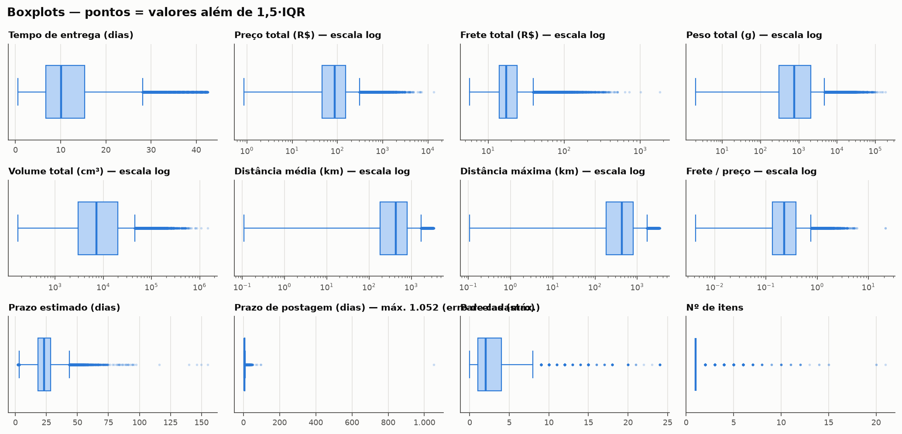

Contagem completa: [`tabelas/outliers_por_variavel.csv`](figures/03_eda/tabelas/outliers_por_variavel.csv).

| Variável | % fora de 1,5·IQR | % fora de 3·IQR | Observação |
|---|---|---|---|
| Peso total | 13,9% | 8,6% | cauda longa real (móveis, eletrodomésticos) |
| Frete total | 10,1% | 5,1% | acompanha peso e distância |
| Nº de itens | 10,0% | 10,0% | IQR = 0 (quase tudo é 1): todo pedido com 2+ itens vira "outlier" |
| Preço total | 7,9% | 4,0% | cauda longa real |
| Prazo de postagem | 7,7% | 3,4% | contém **erros de cadastro** (ver abaixo) |
| Distância | 7,6% | 0,6% | entregas para o Norte/Nordeste — legítimas |
| Tempo de entrega (após limpeza) | 4,3% | 0,3% | |

**Anomalias (prováveis erros de dado):**

| Regra | Pedidos | Interpretação |
|---|---|---|
| `prazo_postagem_dias > 30` | 153 | prazo para postar de até **1.052 dias**: erro de cadastro |
| `parcelas_max == 0` | 2 | 0 parcelas é inválido |
| `prazo_estimado_dias > 60` | 204 | promessa de entrega acima de 2 meses |
| `frete_total == 0` | 334 | frete grátis: legítimo, mas distorce frete/preço |

**Decisão:** nas features, os outliers são, em sua maioria, **valores reais**
(produtos grandes, clientes distantes). Por isso **não removemos linhas** — o
tratamento é por transformação (`log1p`, `RobustScaler`). Sugestão para o
pipeline: fazer *capping* em `prazo_postagem_dias` (ex.: p99,5 ≈ 21 dias).

---

## 4. Matriz de correlações

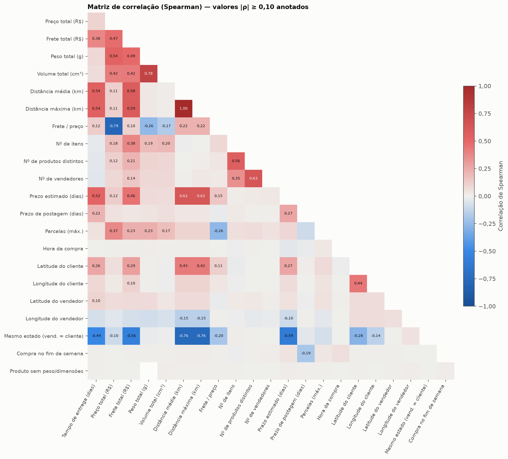

- Usamos **Spearman** (correlação de postos) porque as variáveis têm caudas
  longas e relações não lineares; Pearson é sensível a outliers.

**Correlação de cada feature com o alvo**
([`tabelas/correlacao_com_alvo.csv`](figures/03_eda/tabelas/correlacao_com_alvo.csv)):

| Feature | Spearman | Pearson |
|---|---|---|
| Distância média (km) | **0,54** | 0,45 |
| Prazo estimado (dias) | **0,52** | 0,44 |
| Mesmo estado | **−0,49** | −0,42 |
| Frete total | 0,38 | 0,19 |
| Latitude do cliente | 0,26 | 0,28 |
| Prazo de postagem | 0,22 | 0,14 |
| Preço, peso, volume, nº de itens, hora, fim de semana | < 0,10 | < 0,10 |

- **Fatores logísticos/geográficos dominam**; características do produto
  (preço, peso) e momento da compra quase não se relacionam com o alvo.
- Spearman > Pearson (ex.: frete 0,38 × 0,19) → **relação monotônica, mas não
  linear**: sinal a favor de modelos de árvore/ensemble.

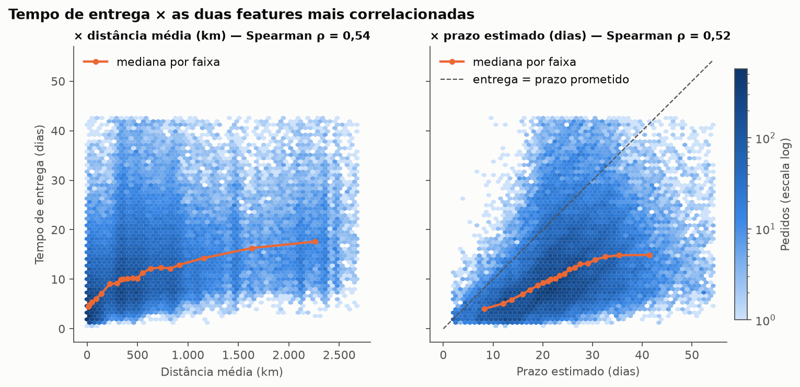

- O tempo cresce rápido até ~500 km e depois "achata" (relação não linear).
- **Prazo estimado × real:** quase todos os pontos ficam **abaixo da diagonal**.
  A Olist promete mediana de **23 dias** e entrega em **10**: a folga mediana é de
  **12 dias** e só **6,9%** dos pedidos atrasam (na base limpa). A promessa atual
  é muito conservadora → **espaço claro para um modelo melhor**.

**Multicolinearidade (|ρ| ≥ 0,7 entre features):**

| Par | Spearman | Implicação |
|---|---|---|
| Distância média × distância máxima | 0,999 | praticamente a mesma variável → manter só uma |
| Preço total × frete/preço | −0,79 | razão derivada do preço |
| Peso × volume | 0,78 | ambos medem "tamanho" do produto |
| Distância × mesmo estado | −0,76 | redundância parcial |

→ Relevante para **Ridge/Lasso** (coeficientes instáveis) no Tópico 4. Árvores
são pouco afetadas.

---

## 5. Mapas geográficos

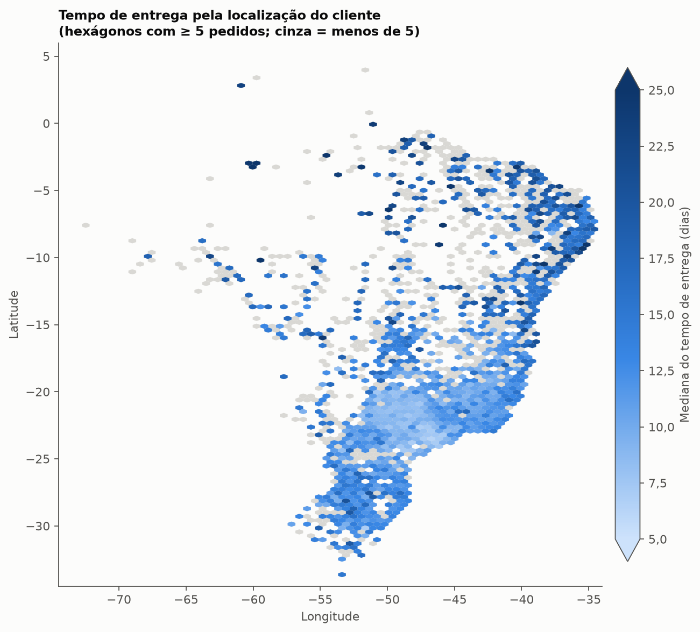

- Cada hexágono = mediana do tempo de entrega dos clientes daquela área
  (latitude/longitude do CEP). **Tons claros (rápido) concentrados em SP/Sudeste;
  tons escuros (lento) no Norte e Nordeste.**

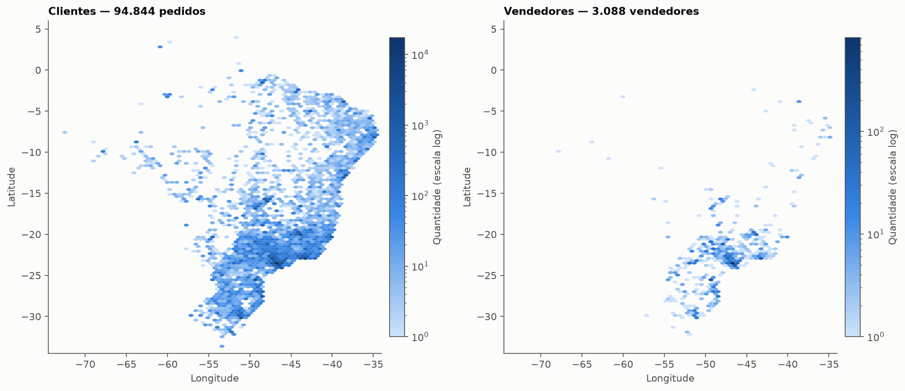

- Clientes estão espalhados por todo o país (42,4% em SP), mas os **3.088
  vendedores** se concentram no eixo SP–Sul–MG: **70,9% dos pedidos saem de SP**.
- Juntando os dois mapas: quanto mais longe do eixo de vendedores, maior o
  tempo de entrega → **a distância é a principal causa do prazo**.

---

## Extra: atraso × nota da review

> Reviews **não entram no modelo** (acontecem depois da entrega → vazamento),
> como definido nos Tópicos 1 e 2. Aqui servem só para medir o impacto do prazo.

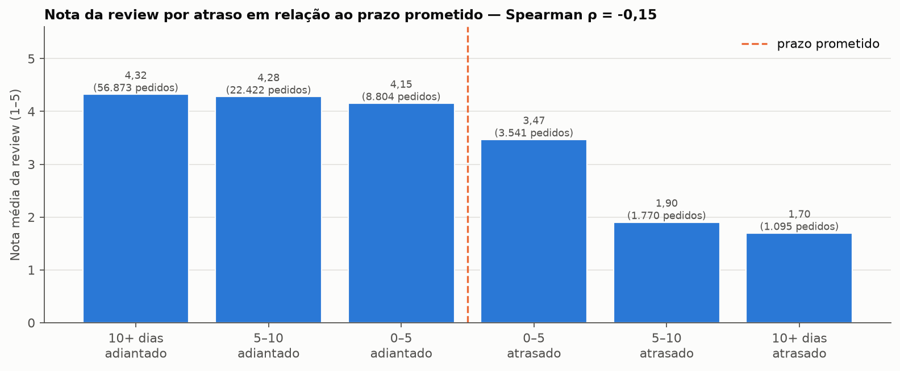

| Entrega em relação ao prazo prometido | Pedidos | Nota média | % notas 1–2 |
|---|---|---|---|
| 10+ dias adiantado | 56.873 | 4,32 | 8,9% |
| 0–5 dias adiantado | 8.804 | 4,15 | 11,0% |
| 0–5 dias atrasado | 3.541 | 3,47 | 27,8% |
| 10+ dias atrasado | 1.095 | **1,70** | **79,3%** |

- A nota **despenca assim que o prazo prometido é ultrapassado**: de ~4,2 para
  1,7. Adiantar mais não melhora muito a nota (4,15 → 4,32).
- A correlação geral é fraca (ρ = −0,15) porque o efeito é de **limiar** (só
  aparece no atraso), não linear.
- **Impacto para a Olist** (conecta com o Tópico 1): prometer um prazo realista
  importa — prometer curto demais gera atraso e nota baixa; prometer longo
  demais (como hoje, folga de 12 dias) afasta o cliente na hora da compra.

---

## O que a EDA nos diz (ponte para o Tópico 4)

1. **Features mais fortes:** distância, prazo estimado, mesmo estado, frete e
   latitude do cliente. Produto e momento da compra pouco ajudam.
2. **Alvo assimétrico** → testar modelo com `log1p(alvo)` (e voltar com `expm1`).
3. **Relações não lineares** (Spearman > Pearson, curva que achata) → árvores e
   ensembles (Random Forest, Gradient Boosting) devem superar modelos lineares.
4. **Multicolinearidade** (distância média × máxima) → considerar remover uma,
   principalmente para Ridge/Lasso.
5. **Baseline natural:** "prever o prazo estimado da Olist". Hoje ele erra por
   ~12 dias na mediana; qualquer modelo útil precisa bater isso.
6. **Ajustes sugeridos ao pré-processamento:** *capping* de
   `prazo_postagem_dias`; `parcelas_max == 0` → ausente.
7. **Cuidado com o split aleatório:** os dados cobrem 2016–2018; um split
   temporal seria mais realista (citar em "melhorias" no Tópico 5).

---

## Onde cada requisito do enunciado é atendido

| Requisito (peso 10%) | Seção | Figuras/tabelas |
|---|---|---|
| Distribuição das variáveis | 2 | `2_dist_*.png` |
| Identificação de outliers | 3 | `3_outliers_alvo.png`, `3_boxplots.png`, `outliers_por_variavel.csv`, `anomalias.csv` |
| Matriz de correlações | 4 | `4_correlacao_heatmap.png`, `4_dispersao_alvo.png`, `correlacao_com_alvo.csv`, `multicolinearidade.csv` |
| Estatísticas descritivas | 1 | `estatisticas_numericas.csv`, `alvo_por_uf_cliente.csv`, `alvo_por_regiao.csv`, `1_alvo_por_uf.png` |
| Mapas geográficos | 5 | `5_mapa_tempo_entrega.png`, `5_mapa_clientes_vendedores.png` |

---

## Sugestão de slides para o vídeo (~2–3 min)

O tópico vale 10% e divide 10–20 min de vídeo com outros 4 tópicos. Este doc e
as figuras são o **material de apoio**; no vídeo, sugerimos 7 slides:

| # | Slide | Figura |
|---|---|---|
| 1 | Base analisada + estatísticas do alvo | tabela da seção 1 |
| 2 | Distribuição do alvo (e do log) | `2_dist_alvo.png` |
| 3 | Outliers: o corte de 42,6 dias | `3_outliers_alvo.png` |
| 4 | Matriz de correlação | `4_correlacao_heatmap.png` |
| 5 | Prazo prometido × real | `4_dispersao_alvo.png` |
| 6 | Mapa do tempo de entrega | `5_mapa_tempo_entrega.png` |
| 7 | Atraso × nota + o que levamos para o modelo | `6_review_por_atraso.png` + seção de insights |

---

## Como reproduzir

```bash
pip install -r requirements.txt
# coloque os CSVs do Kaggle em data/raw/
python src/eda.py
```

Saídas em `docs/figures/03_eda/`: figuras PNG (prontas para os slides) e
`tabelas/*.csv` (estatísticas, outliers, correlações).
