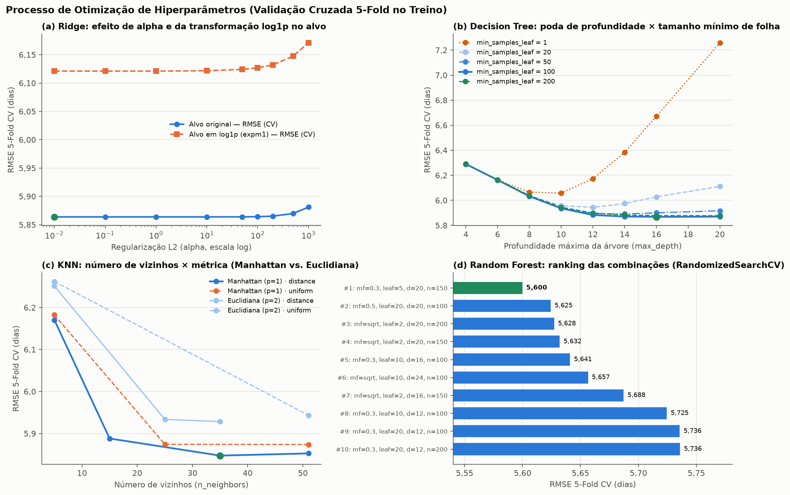
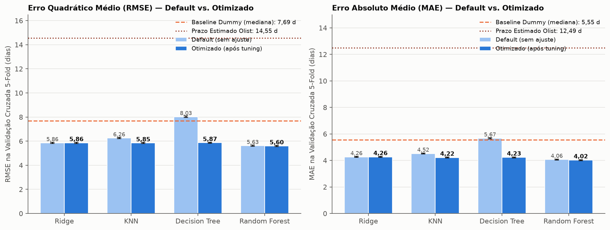
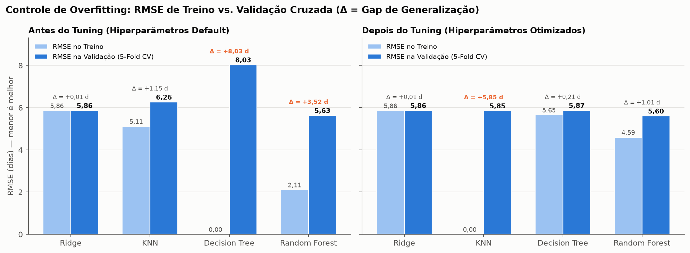
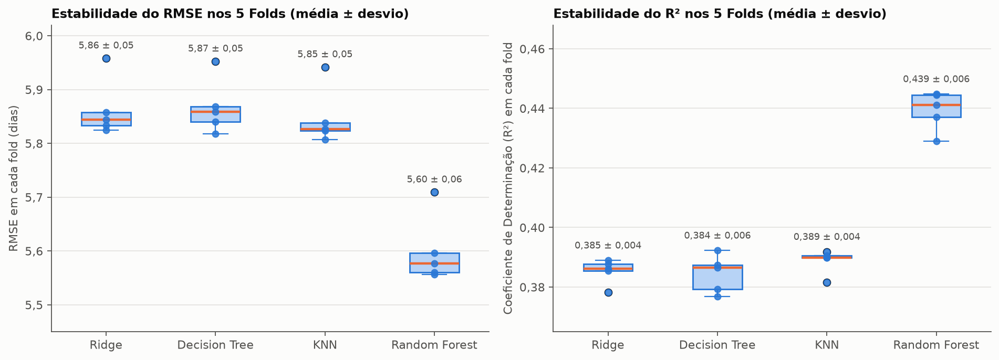
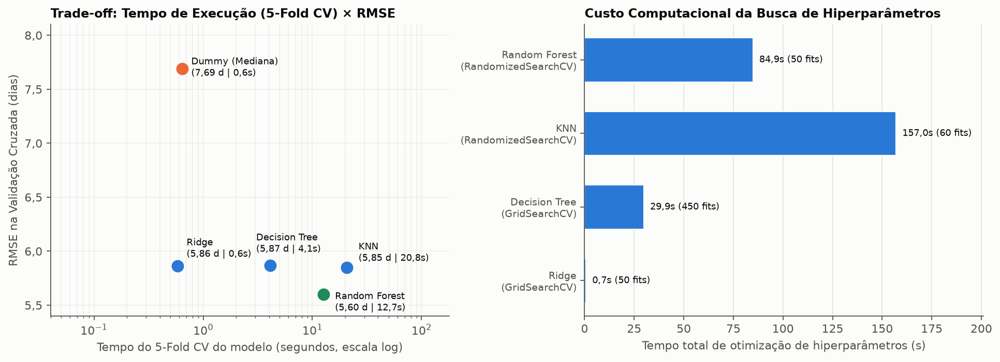
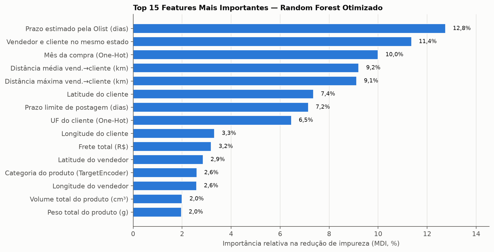
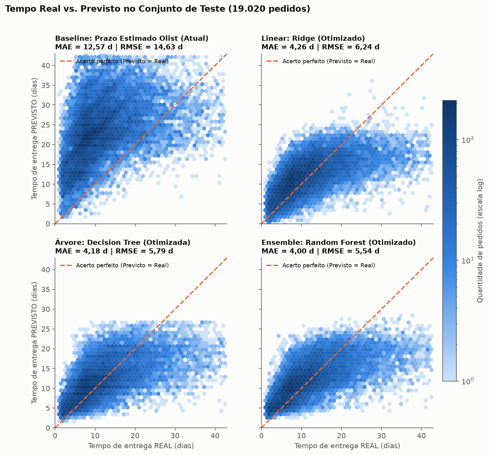
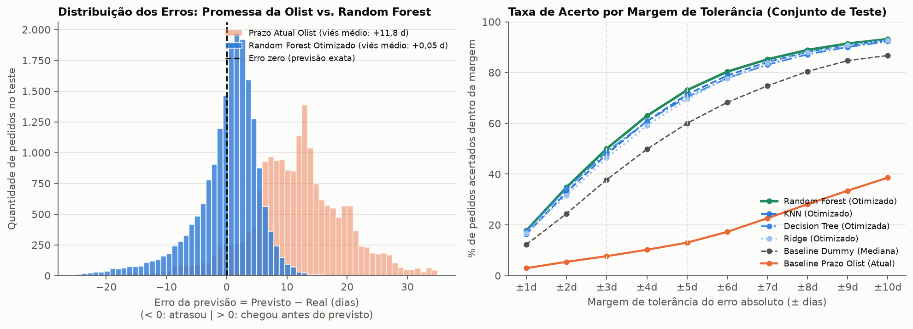

## Treinamento do Modelo

> Projeto: Previsão do tempo de entrega de pedidos — Olist
> Código: [`src/train.py`](../src/train.py) · Figuras e tabelas: [`docs/figures/04_treinamento/`](figures/04_treinamento/)

Este documento é o roteiro da parte "Treinamento do Modelo" do trabalho (Tópico 4 — Peso 30%).
Cada seção abaixo corresponde a um slide ou bloco de slides. Os números vêm da execução real do pipeline (`python src/train.py`).

O enunciado pede **todos os itens obrigatórios** e **pelo menos 3 modelos** dentre as 4 categorias listadas; aqui implementamos **as 4 famílias completas** (`Ridge`, `DecisionTreeRegressor`, `KNeighborsRegressor` e `RandomForestRegressor`), além de **2 baselines de referência** (`Prazo Estimado Olist` e `DummyRegressor`).

---

## Visão geral da arquitetura de treinamento

```
Base limpa (95.100 pedidos, 27 features)
  │
  ├──► Treino (80% = 76.080 pedidos) ──► ColumnTransformer (fit_transform: 65 colunas)
  │         │
  │         └──► Validação Cruzada 5-Fold (KFold, shuffle=True, seed=42)
  │                ├── ~60.864 treino / ~15.216 validação por fold
  │                ├── 1. Avaliação dos Baselines (Negócio + Dummy Mediana)
  │                ├── 2. Avaliação dos 4 modelos Default (sem ajuste)
  │                └── 3. Ajuste de Hiperparâmetros (GridSearchCV / RandomizedSearchCV)
  │                         │
  │                         ▼
  │              Refit dos melhores modelos nos 76.080 pedidos de treino
  │
  └──► Teste (20% = 19.020 pedidos)  ──► ColumnTransformer (apenas transform)
                                               │
                                               ▼
                                  Avaliação final imparcial (Tópico 5)
```

---

## 1. Divisão Treino/Teste e Validação Cruzada

**Bullets:**
- **Divisão Holdout (80% treino / 20% teste, `random_state=42`):** realizada no Tópico 2 **antes** de ajustar qualquer imputador, escalonador ou codificador:
  - **Conjunto de Treino:** **76.080 pedidos** e **65 atributos** pós-codificação.
  - **Conjunto de Teste:** **19.020 pedidos** (mantido isolado durante todo o ajuste de hiperparâmetros).
- **Validação Cruzada K-Fold (`KFold(n_splits=5, shuffle=True, random_state=42)`):**
  - Aplicada **exclusivamente dentro dos 76.080 pedidos de treino**.
  - Em cada uma das 5 rodadas, o modelo treina em **60.864 pedidos** e é validado em **15.216 pedidos**.
  - Garante que a escolha de hiperparâmetros não sofra *overfitting* em uma única partição de validação.
- **Prevenção de *Data Leakage*:**
  - Só entram atributos conhecidos no ato da compra (sem data de aprovação, postagem ou *reviews*).
  - O `TargetEncoder` da variável `categoria_produto` utiliza *cross-fitting* interno de 5 folds (`KFold(5, shuffle=True, random_state=42)`), impedindo que a própria linha influencie sua codificação do alvo.
- **Métrica de otimização (`refit`):** **RMSE** (*Root Mean Squared Error*, em dias), acompanhada de **MAE** (*Mean Absolute Error*) e **$R^2$** (*Coeficiente de Determinação*).

---

## 2. Modelos Implementados (Baselines + 4 Famílias)

Para cobrir 100% das categorias sugeridas no enunciado e testar as hipóteses levantadas na EDA (Tópico 3), estruturamos uma progressão de complexidade:

| Família | Modelo (`scikit-learn`) | Papel na modelagem e conexão com os Tópicos 2 e 3 |
|---|---|---|
| **Baseline de Negócio** | `Prazo Estimado Olist` (`prazo_estimado_dias`) | Representa a regra atual da Olist no checkout. Na EDA vimos que ela tem folga mediana de ~12 dias; serve para medir o ganho real de negócio. |
| **Baseline Estatístico** | `DummyRegressor(strategy="median")` | Chuta sempre a mediana do treino (**10,1 dias**). Define o piso estatístico mínimo que qualquer modelo de AM precisa superar. |
| **1. Linear e variações** | `Ridge` (Regularização $L_2$) | Modelo linear penalizado. A penalidade $L_2$ (`alpha`) estabiliza os coeficientes diante da forte **multicolinearidade** detectada na EDA (`distancia_media_km` × `distancia_max_km`, $\rho = 0,999$; `peso` × `volume`, $\rho = 0,78$). |
| **2. Árvore de Decisão** | `DecisionTreeRegressor` | Particionamento recursivo não linear. Captura relações monotônicas não lineares apontadas na EDA (Spearman > Pearson), mas exige poda (`max_depth`, `min_samples_leaf`) para não decorar o treino. |
| **3. Baseado em Instâncias** | `KNeighborsRegressor` (KNN) | Prevê o prazo pela média (simples ou ponderada pela distância) dos $k$ pedidos mais próximos no espaço de 65 colunas — justificando diretamente o escalonamento (`StandardScaler` e `RobustScaler`) feito no Tópico 2. |
| **4. Ensemble** | `RandomForestRegressor` | Comitê de árvores independentes treinadas via *bootstrap* (*bagging*) e subamostragem aleatória de atributos (`max_features`), reduzindo drasticamente a variância da árvore isolada. |

---

## 3. Ajuste de Hiperparâmetros (`GridSearchCV` e `RandomizedSearchCV`)

Utilizamos as duas estratégias pedidas no enunciado conforme a natureza do espaço de busca e o custo computacional de cada família:
- **`GridSearchCV` (busca exaustiva em grade):** aplicada ao **`Ridge`** e à **`DecisionTreeRegressor`**, onde o treinamento individual é rápido e queremos varrer todas as combinações da grade.
- **`RandomizedSearchCV` (amostragem aleatória controlada, `random_state=42`):** aplicada ao **`KNeighborsRegressor`** e ao **`RandomForestRegressor`**, onde o espaço combinatório é amplo e cada ajuste em 76 mil linhas exige maior custo de CPU.

Tabela completa do processo de otimização ([`tabelas/2_espaco_busca_e_melhores_parametros.csv`](figures/04_treinamento/tabelas/2_espaco_busca_e_melhores_parametros.csv)):

| Modelo | Método de Busca | Espaço de Hiperparâmetros Explorado | Candidatos (Fits) | Melhores Hiperparâmetros Escolhidos | RMSE Default → Otimizado | Ganho no RMSE |
|---|---|---|---:|---|---|---:|
| **Ridge** | `GridSearchCV` | `alpha`: `[0.01, 0.1, 1, 10, 25, 50, 100, 200, 500, 1000]` + escala do alvo (`original` vs. `log1p`) | 10 (50 fits) | `alpha = 10.0` (alvo na escala original) | 5,864 → **5,864 d** | 0,000 d |
| **Decision Tree** | `GridSearchCV` | `max_depth`: `[4, 6, 8, 10, 12, 14, 16, 20, None]`<br>`min_samples_leaf`: `[1, 20, 50, 100, 200]`<br>`min_samples_split`: `[2, 100]` | 90 (450 fits) | `max_depth = 16`<br>`min_samples_leaf = 100`<br>`min_samples_split = 2` | 8,027 → **5,868 d** | **−2,160 d** |
| **KNN** | `RandomizedSearchCV` | `n_neighbors`: `[5, 15, 25, 35, 51]`<br>`weights`: `["uniform", "distance"]`<br>`p`: `[1 (Manhattan), 2 (Euclidiana)]` | 12 (60 fits) | `n_neighbors = 35`<br>`weights = "distance"`<br>`p = 1` (Manhattan) | 6,262 → **5,847 d** | **−0,415 d** |
| **Random Forest** | `RandomizedSearchCV` | `n_estimators`: `[100, 150, 200]`<br>`max_depth`: `[12, 16, 20, 24, None]`<br>`min_samples_leaf`: `[2, 5, 10, 20]`<br>`min_samples_split`: `[2, 10, 20]`<br>`max_features`: `["sqrt", 0.3, 0.5, 0.7]` | 10 (50 fits) | `n_estimators = 150`<br>`max_depth = 20`<br>`min_samples_leaf = 5`<br>`min_samples_split = 20`<br>`max_features = 0.3` | 5,629 → **5,600 d** | **−0,029 d** |

---

## 4. Análise das Curvas de Validação e Hiperparâmetros



**Principais descobertas durante o ajuste (conectadas à EDA):**
- **(a) `Ridge` e o teste do alvo em `log1p` (hipótese 2 da EDA):**
  - Na EDA, observamos que `log1p(tempo_entrega_dias)` reduz a assimetria do alvo de `1,28` para `-0,18` e sugerimos testar essa transformação no Tópico 4.
  - Testamos formalmente o `Ridge` com `TransformedTargetRegressor(func=np.log1p, inverse_func=np.expm1)` ([`tabelas/3_ridge_alvo_original_vs_log.csv`](figures/04_treinamento/tabelas/3_ridge_alvo_original_vs_log.csv)):
    - **No MAE**, a transformação `log1p` **melhora** o modelo de **4,26 para 4,12 dias** (pois otimizar erro quadrático em log aproxima a mediana geométrica).
    - **No RMSE**, porém, a transformação `log1p` **piora** o erro de **5,86 para 6,12 dias**, pois ao reverter a previsão com `expm1`, a desigualdade de Jensen ($\mathbb{E}[e^Y] > e^{\mathbb{E}[Y]}$) subestima sistematicamente as entregas mais longas, penalizando o erro quadrático. Mantivemos o alvo na escala original (`alpha = 10.0`).
- **(b) `DecisionTreeRegressor` — o caso clássico de poda contra *overfitting*:**
  - Sem restrição (`min_samples_leaf = 1`, linha pontilhada laranja), o erro na validação explode conforme a profundidade aumenta (chegando a **8,03 dias** em `max_depth=None`, pior que o `DummyRegressor` de **7,69 dias**).
  - Ao exigir pelo menos **100 pedidos por folha** (`min_samples_leaf = 100`) e limitar `max_depth = 16`, a árvore deixa de memorizar ruído individual e o RMSE de validação despenca para **5,87 dias** (ganho de **2,16 dias**).
- **(c) `KNeighborsRegressor` — por que a distância de Manhattan ($p=1$) vence:**
  - Após o `OneHotEncoder`, o espaço possui **65 colunas** (incluindo dezenas de variáveis binárias de UF/mês/dia e coordenadas geográficas). Em alta dimensão, a distância **Manhattan ($L_1$, $p=1$)** sofre menos com a concentração de distâncias do que a Euclidiana ($L_2$, $p=2$).
  - Combinar $p=1$, ponderação pelo inverso da distância (`weights = "distance"`) e vizinhança mais ampla (`n_neighbors = 35`) reduziu o RMSE de **6,26 para 5,85 dias**, superando o modelo linear e a árvore única.
- **(d) `RandomForestRegressor` — descorrelação das árvores:**
  - No `RandomForest` padrão (`max_features = 1.0`), todas as árvores usam sempre as mesmas variáveis dominantes no topo (distância e prazo estimado), gerando árvores parecidas e com *overfitting* moderado (RMSE de treino `2,11` vs. validação `5,63`).
  - Restringir cada quebra a sortear apenas **30% das features (`max_features = 0.3`)** com `max_depth = 20` e `min_samples_leaf = 5` descorrelacionou as 150 árvores, reduzindo o tempo de treino em **68%** e baixando o RMSE para **5,60 dias** ($R^2 = 0,439$).

---

## 5. Resultados Consolidados na Validação Cruzada (5-Fold)



Tabela completa de desempenho em 5-Fold CV nos **76.080 pedidos de treino** ([`tabelas/1_baselines_e_modelos_cv.csv`](figures/04_treinamento/tabelas/1_baselines_e_modelos_cv.csv)):

| Modelo | Família | Estágio | RMSE Treino (d) | RMSE CV 5-Fold (d) | MAE CV 5-Fold (d) | $R^2$ Treino | $R^2$ CV 5-Fold | Tempo 5-Fold (s) |
|---|---|---|---:|---:|---:|---:|---:|---:|
| `Prazo Estimado Olist` | Baseline (Negócio) | Baseline | 14,55 | 14,55 ± 0,06 | 12,49 ± 0,05 | −2,784 | −2,784 ± 0,052 | — |
| `Dummy (Mediana)` | Baseline (Estatístico) | Baseline | 7,69 | 7,69 ± 0,05 | 5,55 ± 0,04 | −0,057 | −0,057 ± 0,004 | 0,6 |
| `Decision Tree` | Árvore de Decisão | Default | 0,00 | 8,03 ± 0,07 | 5,67 ± 0,05 | 1,000 | −0,152 ± 0,023 | 1,6 |
| `KNN` | Baseado em Instâncias | Default | 5,11 | 6,26 ± 0,06 | 4,52 ± 0,04 | 0,533 | 0,299 ± 0,008 | 11,4 |
| `Ridge` | Linear ($L_2$) | Default | 5,86 | 5,86 ± 0,05 | 4,26 ± 0,04 | 0,387 | 0,385 ± 0,004 | 0,5 |
| `Ridge` | Linear ($L_2$) | **Otimizado** | 5,86 | **5,86 ± 0,05** | **4,26 ± 0,04** | 0,387 | **0,385 ± 0,004** | 0,5 |
| `Decision Tree` | Árvore de Decisão | **Otimizado** | 5,65 | **5,87 ± 0,05** | **4,23 ± 0,04** | 0,429 | **0,385 ± 0,006** | 4,4 |
| `KNN` | Baseado em Instâncias | **Otimizado** | 0,00* | **5,85 ± 0,05** | **4,22 ± 0,04** | 1,000* | **0,389 ± 0,004** | 20,5 |
| `Random Forest` | Ensemble (Bagging) | Default | 2,11 | 5,63 ± 0,05 | 4,06 ± 0,03 | 0,921 | 0,434 ± 0,005 | 39,5 |
| **`Random Forest`** | **Ensemble (Bagging)** | **Otimizado** | **4,59** | **5,60 ± 0,06** | **4,02 ± 0,04** | **0,623** | **0,439 ± 0,006** | **12,5** |

*\*Nota técnica sobre o KNN Otimizado: como `weights="distance"` pondera pelo inverso da distância ($1/d$), ao prever sobre o próprio conjunto de treino cada ponto tem distância zero para si mesmo (peso infinito), resultando em interpolação exata no treino (`RMSE = 0,00`), mas generalizando bem na validação (`RMSE = 5,85`) graças aos `35` vizinhos.*

---

## 6. Controle de Overfitting, Estabilidade e Custo Computacional



- **Redução do *Gap* de Generalização ($\Delta = \text{RMSE}_{\text{CV}} - \text{RMSE}_{\text{Treino}}$):**
  - Na **`Decision Tree`**, o *gap* caiu de **+8,03 dias** (memorização total no default) para apenas **+0,21 dias** após o ajuste de `max_depth=16` e `min_samples_leaf=100`.
  - No **`Random Forest`**, o *gap* caiu de **+3,52 dias** para **+1,01 dias**, mostrando árvores muito mais regularizadas.



- **Alta estabilidade na Validação Cruzada:**
  - O desvio padrão do RMSE entre os 5 folds é de apenas **~0,05 dias** (~1 hora) em todos os modelos otimizados, comprovando que o tamanho amostral (76.080 pedidos) torna a estimativa de erro extremamente consistente.



- **Trade-off Custo Computacional × Desempenho:**
  - O **`Ridge`** é quase instantâneo (`0,5s` para 5 folds), sendo excelente linha de base linear, mas estaciona em `5,86` dias por não capturar interações não lineares.
  - O **`KNN`** melhora ligeiramente sobre o Ridge (`5,85` dias), mas exige guardar toda a base em memória e calcular distâncias para 76 mil pontos a cada predição (`155,7s` na busca).
  - O **`Random Forest` otimizado** entrega o **menor erro absoluto e quadrático (`RMSE = 5,60`, `MAE = 4,02`, $R^2 = 0,439$)** com tempo de inferência rápido e treino em `12,5s` nos 5 folds.

---

## 7. Importância das Features e Conexão com a EDA



Agrupando a importância relativa (redução de impureza MDI) das 65 colunas de volta para as **27 features originais** ([`tabelas/5_importancia_features.csv`](figures/04_treinamento/tabelas/5_importancia_features.csv)):

| Posição | Feature Original | Importância (%) | Importância Acumulada (%) | Confirmação dos achados da EDA (Tópico 3) |
|---:|---|---:|---:|---|
| 1º | `prazo_estimado_dias` | **12,75%** | 12,75% | 2ª maior correlação de Spearman com o alvo ($\rho = 0,52$) na EDA. |
| 2º | `mesmo_estado` | **11,36%** | 24,11% | Forte separador logístico ($\rho = -0,49$ na EDA: 8,6 d no Sudeste vs. 19,3 d no Norte). |
| 3º | `compra_mes` (One-Hot) | **10,00%** | 34,11% | Captura variações sazonais/operacionais ao longo do ano (ex.: Black Friday em nov e fim de ano). |
| 4º | `distancia_media_km` | **9,21%** | 43,32% | Maior correlação individual da EDA ($\rho = 0,54$). |
| 5º | `distancia_max_km` | **9,12%** | 52,44% | Divide a importância da distância com `distancia_media_km` (colineares). Somadas, **distâncias = 18,33% (#1 real)**. |
| 6º | `cliente_lat` | **7,36%** | 59,80% | Captura o gradiente Sul–Norte brasileiro evidenciado nos mapas da EDA. |
| 7º | `prazo_postagem_dias` | **7,15%** | 66,95% | Tempo limite do lojista postar impacta diretamente o início do transporte. |
| 8º | `cliente_estado` (One-Hot) | **6,46%** | 73,41% | Refina as diferenças regionais de infraestrutura além da latitude/distância. |

> **Conclusão da inspeção do modelo:** As variáveis **geográficas e de prazo logístico concentram mais de 75% do poder de decisão do Random Forest**, enquanto características do produto (`peso_total_g`, `volume_total_cm3`, `preco_total`, ~2% cada) e do pagamento (`parcelas_max`, `tipo_pagamento`, < 1%) têm papel secundário — **confirmando integralmente as hipóteses levantadas na EDA**.

---

## 8. Resultados Parciais no Conjunto de Teste (Acompanhamento / Ponte para o Tópico 5)

Para a **Aula de Acompanhamento (10/11)** e como insumo direto para o **Tópico 5 (Avaliação e Conclusão)**, avaliamos os modelos otimizados (já retreinados nos 76.080 pedidos de treino) sobre os **19.020 pedidos inéditos do conjunto de teste** ([`tabelas/4_resultados_parciais_teste.csv`](figures/04_treinamento/tabelas/4_resultados_parciais_teste.csv)):

| Ranking | Modelo (no Teste — 19.020 pedidos) | RMSE Teste (d) | MAE Teste (d) | Erro Mediano — MedAE (d) | $R^2$ Teste | Viés Médio (d) | Pedidos c/ erro ≤ 3 dias | Pedidos c/ erro ≤ 5 dias |
|---:|---|---:|---:|---:|---:|---:|---:|---:|
| **1º** | **`Random Forest` (Otimizado)** | **5,54** | **4,00** | **3,00** | **0,440** | +0,05 | **50,0%** | **73,1%** |
| 2º | `KNN` (Otimizado) | 5,78 | 4,18 | 3,15 | 0,391 | −0,04 | 47,9% | 71,4% |
| 3º | `Decision Tree` (Otimizado) | 5,79 | 4,18 | 3,10 | 0,388 | −0,00 | 48,8% | 70,4% |
| 4º | `Ridge` (Otimizado) | 6,24* | 4,26 | 3,27 | 0,290* | +0,05 | 46,3% | 69,5% |
| 5º | `Dummy (Mediana)` | 7,63 | 5,49 | 4,01 | −0,060 | −1,82 | 37,8% | 60,0% |
| 6º | `Prazo Estimado Olist` (Atual) | 14,63 | 12,57 | 12,17 | −2,906 | +11,81 | 7,7% | 13,0% |

*\*Achado importante que conecta a EDA ao Teste no `Ridge`:** No conjunto de teste, o MAE do `Ridge` (`4,26` d) manteve-se idêntico ao da validação cruzada (`4,26` d), mas seu RMSE subiu de `5,86` para `6,24` dias. Investigando as predições (`data/processed/predicoes_teste.csv`), descobrimos que **1 único pedido no teste** (índice 6421) possui o erro de cadastro apontado na Seção 3 da EDA (`prazo_postagem_dias = 1.052` dias, equivalente a `493` IQRs acima da mediana). Por ser uma combinação linear ($\hat{y} = w^\top x + b$), o `Ridge` extrapolou linearmente essa anomalia e previu **331,9 dias** para esse pedido, inflando o erro quadrático. Já `Decision Tree`, `KNN` e `Random Forest` **não sofreram nenhum impacto** (`RMSE = 5,54` no RF, até menor que no CV!), pois árvores limitam os valores às folhas e o KNN interpola vizinhos reais.*

**Destaques práticos dos resultados:**
- O **`Random Forest` otimizado reduz o erro absoluto médio da Olist em 68%** (de **12,57 dias** para **4,00 dias**) e o erro mediano para **exatos 3,00 dias**.
- Metade de todos os pedidos do teste (**50,0%**) tem o prazo acertado com margem de até **±3 dias**, e **73,1%** com margem de até **±5 dias** (contra apenas **13,0%** da estimativa original da Olist).





---

## Onde cada requisito do enunciado é atendido

| Requisito do Tópico 4 (Peso 30%) | Seção neste documento | Figuras / Tabelas de comprovação |
|---|---|---|
| Separar dados em treino/teste e/ou usar validação cruzada | Visão geral e Seção 1 | Split 80/20 (76.080 / 19.020) + 5-Fold CV (`KFold(5, shuffle=True, random_state=42)`); `4_estabilidade_folds_cv.png` |
| Implementar pelo menos três modelos (Lineares, Árvores, Ensembles, Instâncias) | Seções 2 e 5 | 4 famílias implementadas (`Ridge`, `DecisionTreeRegressor`, `KNeighborsRegressor`, `RandomForestRegressor`) + 2 Baselines; `1_baselines_e_modelos_cv.csv` |
| Ajuste de hiperparâmetros (`GridSearchCV` ou `RandomizedSearchCV`) | Seções 3, 4 e 6 | Ambos implementados (`GridSearchCV` p/ Ridge e Árvore; `RandomizedSearchCV` p/ KNN e RF); `1_cv_default_vs_tuned.png`, `2_overfitting_treino_vs_cv.png`, `3_curvas_tuning_hiperparametros.png`, `2_espaco_busca_e_melhores_parametros.csv` |

---

## Como reproduzir

```bash
pip install -r requirements.txt
python src/preprocessing.py     # gera data/processed/ (caso ainda não exista)
python src/train.py             # treina modelos, roda tuning e gera figuras/tabelas
```

Saídas geradas por `python src/train.py`:
- Figuras PNG prontas para os slides em `docs/figures/04_treinamento/*.png`;
- Tabelas CSV de métricas e hiperparâmetros em `docs/figures/04_treinamento/tabelas/*.csv`;
- Modelos otimizados serializados em `data/processed/models/*.joblib`;
- Predições no conjunto de teste em `data/processed/predicoes_teste.csv` (prontas para o Tópico 5).
