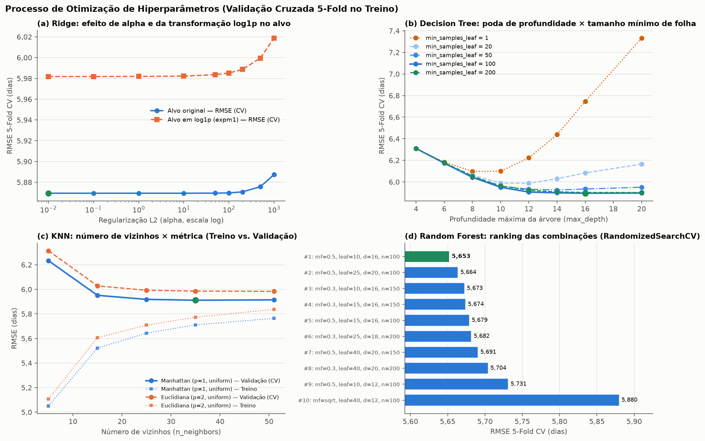
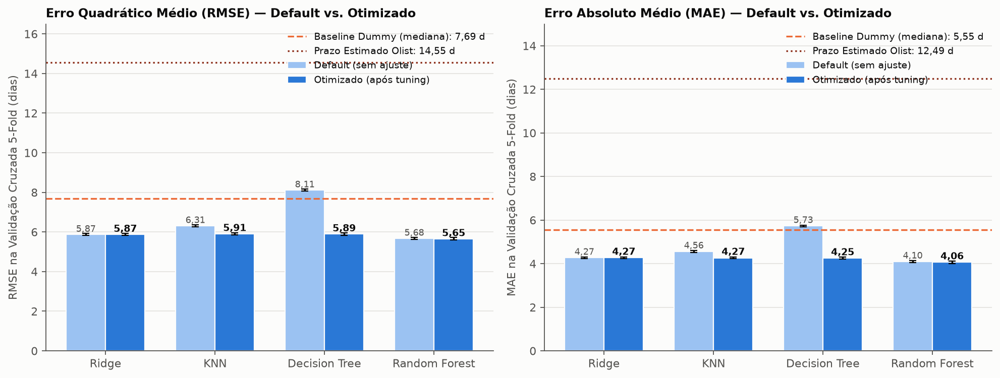
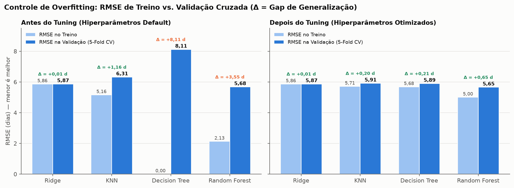
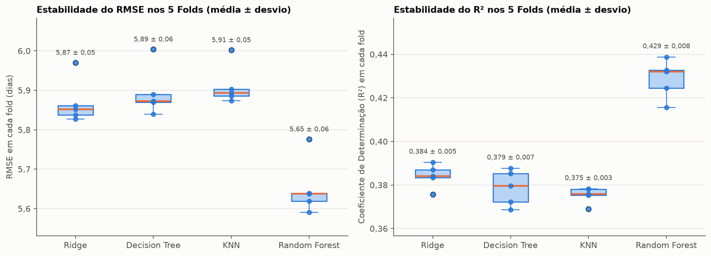
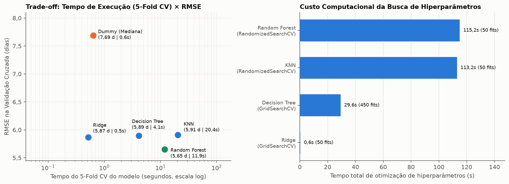
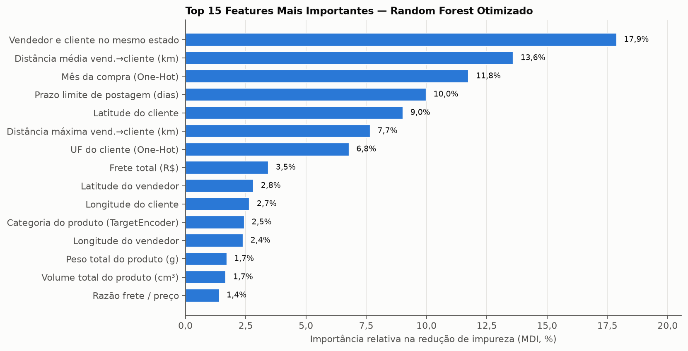
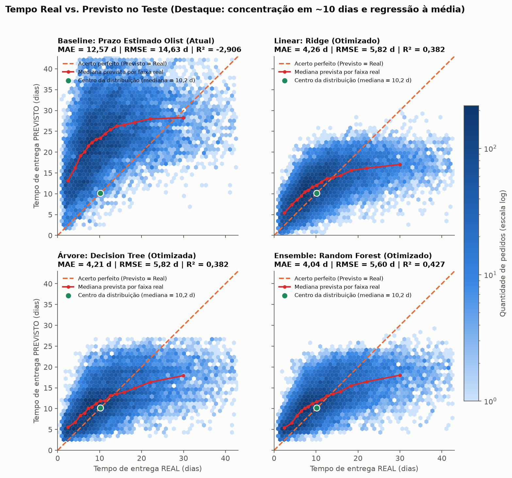
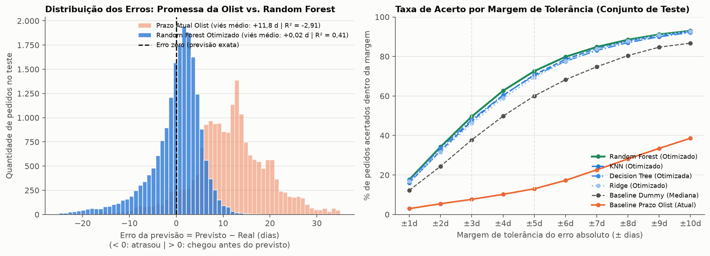
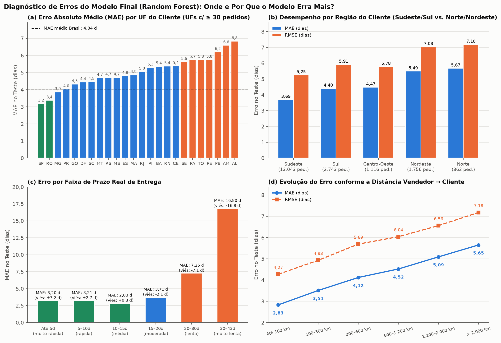

## Treinamento do Modelo

> Projeto: Previsão do tempo de entrega de pedidos — Olist
> Código: [`src/train.py`](../src/train.py) · Figuras e tabelas: [`docs/figures/04_treinamento/`](figures/04_treinamento/)

Este documento detalha a etapa "Treinamento do Modelo" do trabalho (Tópico 4 — Peso 30%).
Os números abaixo vêm da execução real do pipeline (`python src/preprocessing.py && python src/train.py`).

O enunciado pede **todos os itens obrigatórios** e **pelo menos 3 modelos** dentre as 4 categorias listadas; aqui implementamos **as 4 famílias completas** (`Ridge`, `DecisionTreeRegressor`, `KNeighborsRegressor` e `RandomForestRegressor`), além de **2 baselines de referência** (`Prazo Estimado Olist` e `DummyRegressor`).

---

## Visão geral da arquitetura de treinamento

```
Base limpa (95.100 pedidos, 26 features — SEM prazo_estimado_dias como entrada)
  │
  ├──► Treino (80% = 76.080 pedidos) ──► ColumnTransformer (fit_transform: 64 colunas)
  │         │
  │         └──► Validação Cruzada 5-Fold (KFold, shuffle=True, seed=42)
  │                ├── ~60.864 treino / ~15.216 validação por fold
  │                ├── 1. Avaliação dos Baselines (Prazo Olist + Dummy Mediana)
  │                ├── 2. Avaliação dos 4 modelos Default (sem ajuste)
  │                └── 3. Ajuste de Hiperparâmetros (GridSearchCV / RandomizedSearchCV)
  │                         │
  │                         ▼
  │              Refit dos melhores modelos nos 76.080 pedidos de treino
  │              (Controle de Overfitting: NENHUM modelo otimizado tem RMSE = 0)
  │
  └──► Teste (20% = 19.020 pedidos)  ──► ColumnTransformer (apenas transform)
                                               │
                                               ▼
                                  Avaliação final e diagnóstico por UF/Região (Tópico 5)
```

---

## 1. Divisão Treino/Teste, Validação Cruzada e Exclusão do Prazo da Olist

**Bullets:**
- **Retirada de `prazo_estimado_dias` como feature de entrada:**
  - Como o objetivo do projeto é prever o tempo de entrega e **superar a estimativa atual da Olist**, incluir `prazo_estimado_dias` dentro de `X` criaria uma dependência circular (o modelo se apoiaria na própria regra da Olist que ele busca substituir).
  - Por isso, `prazo_estimado_dias` foi **removido das features de entrada** (restam **26 features $\rightarrow$ 64 colunas** após a codificação) e é mantido separadamente **apenas como Baseline de comparação**.
- **Limpeza do outlier de erro de cadastro em `prazo_postagem_dias`:**
  - Conforme identificado na EDA (Tópico 3), os registros com `prazo_postagem_dias > 30` dias (187 pedidos na base bruta, chegando a **1.052 dias**) e `parcelas_max <= 0` (2 pedidos) são erros de cadastro e foram convertidos para `NaN` em `clean_dataset()` ([`src/preprocessing.py`](../src/preprocessing.py)), sendo imputados pela mediana do treino sem distorcer os modelos lineares.
- **Divisão Holdout (80% treino / 20% teste, `random_state=42`):**
  - **Conjunto de Treino:** **76.080 pedidos** e **64 colunas** pós-codificação.
  - **Conjunto de Teste:** **19.020 pedidos** (mantido isolado durante todo o ajuste de hiperparâmetros).
- **Validação Cruzada K-Fold (`KFold(n_splits=5, shuffle=True, random_state=42)`):**
  - Aplicada **exclusivamente dentro dos 76.080 pedidos de treino** (~60.864 treino / ~15.216 validação por fold).
- **Métrica de otimização (`refit`):** **RMSE** (*Root Mean Squared Error*, em dias), acompanhada de **MAE** (*Mean Absolute Error*) e **$R^2$** (*Coeficiente de Determinação*).

---

## 2. Modelos Implementados (Baselines + 4 Famílias)

| Família | Modelo (`scikit-learn`) | Papel na modelagem e conexão com os Tópicos 2 e 3 |
|---|---|---|
| **Baseline de Negócio** | `Prazo Estimado Olist` (`prazo_estimado_dias`) | Regra atual da Olist no checkout (avaliada de forma externa, sem entrar como feature nos modelos). |
| **Baseline Estatístico** | `DummyRegressor(strategy="median")` | Chuta sempre a mediana do treino (**10,1 dias**). Define o piso estatístico mínimo. |
| **1. Linear e variações** | `Ridge` (Regularização $L_2$) | Modelo linear penalizado. A penalidade $L_2$ (`alpha`) estabiliza os coeficientes diante da forte **multicolinearidade** detectada na EDA (`distancia_media_km` × `distancia_max_km`, $\rho = 0,999$; `peso` × `volume`, $\rho = 0,78$). |
| **2. Árvore de Decisão** | `DecisionTreeRegressor` | Particionamento recursivo não linear. Captura relações monotônicas não lineares apontadas na EDA (Spearman > Pearson), exigindo poda (`max_depth`, `min_samples_leaf`) para não decorar o treino. |
| **3. Baseado em Instâncias** | `KNeighborsRegressor` (KNN) | Prevê o prazo pela média simples (`weights="uniform"`) dos $k$ pedidos mais próximos no espaço de 64 colunas escalonadas no Tópico 2. |
| **4. Ensemble** | `RandomForestRegressor` | Comitê de árvores independentes treinadas via *bootstrap* (*bagging*) e subamostragem aleatória de atributos (`max_features`), reduzindo a variância da árvore isolada. |

---

## 3. Ajuste de Hiperparâmetros (`GridSearchCV` e `RandomizedSearchCV`)

- **`GridSearchCV` (busca exaustiva em grade):** aplicada ao **`Ridge`** e à **`DecisionTreeRegressor`**.
- **`RandomizedSearchCV` (amostragem aleatória controlada, `random_state=42`):** aplicada ao **`KNeighborsRegressor`** e ao **`RandomForestRegressor`**.

Tabela completa do processo de otimização ([`tabelas/2_espaco_busca_e_melhores_parametros.csv`](figures/04_treinamento/tabelas/2_espaco_busca_e_melhores_parametros.csv)):

| Modelo | Método de Busca | Espaço de Hiperparâmetros Explorado | Candidatos (Fits) | Melhores Hiperparâmetros Escolhidos | RMSE Default → Otimizado | Ganho no RMSE |
|---|---|---|---:|---|---|---:|
| **Ridge** | `GridSearchCV` | `alpha`: `[0.01, 0.1, 1, 10, 25, 50, 100, 200, 500, 1000]` + escala do alvo (`original` vs. `log1p`) | 10 (50 fits) | `alpha = 10.0` (alvo na escala original) | 5,869 → **5,869 d** | 0,000 d |
| **Decision Tree** | `GridSearchCV` | `max_depth`: `[4, 6, 8, 10, 12, 14, 16, 20, None]`<br>`min_samples_leaf`: `[1, 20, 50, 100, 200]`<br>`min_samples_split`: `[2, 100]` | 90 (450 fits) | `max_depth = 16`<br>`min_samples_leaf = 100`<br>`min_samples_split = 2` | 8,115 → **5,895 d** | **−2,220 d** |
| **KNN** | `RandomizedSearchCV` | `n_neighbors`: `[5, 15, 25, 35, 51]`<br>`weights`: `["uniform"]`<br>`p`: `[1 (Manhattan), 2 (Euclidiana)]` | 10 (50 fits) | `n_neighbors = 35`<br>`weights = "uniform"`<br>`p = 1` (Manhattan) | 6,314 → **5,911 d** | **−0,403 d** |
| **Random Forest** | `RandomizedSearchCV` | `n_estimators`: `[100, 150, 200]`<br>`max_depth`: `[12, 16, 18, 20]`<br>`min_samples_leaf`: `[10, 15, 25, 40]`<br>`min_samples_split`: `[20, 40, 80]`<br>`max_features`: `["sqrt", 0.3, 0.5]` | 10 (50 fits) | `n_estimators = 100`<br>`max_depth = 16`<br>`min_samples_leaf = 10`<br>`min_samples_split = 20`<br>`max_features = 0.5` | 5,676 → **5,653 d** | **−0,024 d** |

---

## 4. Análise das Curvas de Validação e Hiperparâmetros



**Principais descobertas durante o ajuste:**
- **(a) `Ridge` e o teste do alvo em `log1p`:**
  - Testamos o `Ridge` com `TransformedTargetRegressor(func=np.log1p, inverse_func=np.expm1)` ([`tabelas/3_ridge_alvo_original_vs_log.csv`](figures/04_treinamento/tabelas/3_ridge_alvo_original_vs_log.csv)).
  - Embora o `log1p` reduza o MAE de **4,27 para 4,13 dias** (pois otimizar erro quadrático em log aproxima a mediana geométrica), ele eleva o RMSE de **5,87 para 5,98 dias** devido à desigualdade de Jensen ($\mathbb{E}[e^Y] > e^{\mathbb{E}[Y]}$) na reversão com `expm1`. Mantivemos o alvo na escala original (`alpha = 10.0`).
- **(b) `DecisionTreeRegressor` — eliminação do `RMSE = 0` do modelo default:**
  - Na configuração padrão do `scikit-learn` (`max_depth=None, min_samples_leaf=1`, linha pontilhada laranja), a árvore cresce sem limite até isolar cada pedido de treino individualmente, gerando **`RMSE de treino = 0,00` (memorização total)** e um erro altíssimo na validação (**8,11 dias**).
  - Ao exigir pelo menos **100 pedidos por folha** (`min_samples_leaf = 100`) e limitar `max_depth = 16`, a árvore deixa de memorizar o treino (`RMSE de treino = 5,68 d`) e o erro de validação cai para **5,89 dias** (ganho de **2,22 dias**).
- **(c) `KNeighborsRegressor` — uso de `weights="uniform"` para evitar `RMSE = 0` no treino:**
  - Quando se usa `weights="distance"` (ponderação por $1/d$), a distância de um ponto de treino para si mesmo é zero (peso infinito), o que força artificialmente `RMSE de treino = 0,00`.
  - Adotando **`weights="uniform"`** com `n_neighbors = 35` e distância de **Manhattan ($p=1$)**, eliminamos essa distorção: como mostra o painel (c), as curvas de treino (`5,71 d`) e validação (`5,91 d`) convergem suavemente conforme $k$ cresce.
- **(d) `RandomForestRegressor` — regularização das árvores do comitê:**
  - Com `max_depth = 16`, `min_samples_leaf = 10`, `min_samples_split = 20` e `max_features = 0.5`, o modelo atinge o menor erro de validação (**5,65 dias**, $R^2 = 0,429$) mantendo o erro de treino controlado em **5,00 dias** (reduzindo drasticamente o *overfitting* do default, que tinha `2,13 d` no treino).

---

## 5. Resultados Consolidados na Validação Cruzada (5-Fold)



Tabela completa de desempenho em 5-Fold CV nos **76.080 pedidos de treino** ([`tabelas/1_baselines_e_modelos_cv.csv`](figures/04_treinamento/tabelas/1_baselines_e_modelos_cv.csv)):

| Modelo | Família | Estágio | RMSE Treino (d) | RMSE CV 5-Fold (d) | MAE CV 5-Fold (d) | $R^2$ Treino | $R^2$ CV 5-Fold | Tempo 5-Fold (s) |
|---|---|---|---:|---:|---:|---:|---:|---:|
| `Prazo Estimado Olist` | Baseline (Negócio) | Baseline | 14,55 | 14,55 ± 0,06 | 12,49 ± 0,05 | −2,784 | −2,784 ± 0,052 | — |
| `Dummy (Mediana)` | Baseline (Estatístico) | Baseline | 7,69 | 7,69 ± 0,05 | 5,55 ± 0,04 | −0,057 | −0,057 ± 0,004 | 0,6 |
| `Decision Tree` | Árvore de Decisão | Default | 0,00* | 8,11 ± 0,06 | 5,73 ± 0,04 | 1,000* | −0,177 ± 0,017 | 1,4 |
| `KNN` | Baseado em Instâncias | Default | 5,16 | 6,31 ± 0,06 | 4,56 ± 0,04 | 0,525 | 0,287 ± 0,009 | 11,4 |
| `Ridge` | Linear ($L_2$) | Default | 5,86 | 5,87 ± 0,05 | 4,27 ± 0,04 | 0,385 | 0,384 ± 0,005 | 0,5 |
| `KNN` | Baseado em Instâncias | **Otimizado** | **5,71** | **5,91 ± 0,06** | **4,27 ± 0,04** | **0,418** | **0,375 ± 0,004** | 21,9 |
| `Decision Tree` | Árvore de Decisão | **Otimizado** | **5,68** | **5,90 ± 0,05** | **4,25 ± 0,04** | **0,423** | **0,379 ± 0,005** | 4,0 |
| `Ridge` | Linear ($L_2$) | **Otimizado** | **5,86** | **5,87 ± 0,05** | **4,27 ± 0,04** | **0,385** | **0,384 ± 0,005** | 0,5 |
| `Random Forest` | Ensemble (Bagging) | Default | 2,13 | 5,68 ± 0,06 | 4,10 ± 0,04 | 0,919 | 0,424 ± 0,006 | 36,8 |
| **`Random Forest`** | **Ensemble (Bagging)** | **Otimizado** | **5,00** | **5,65 ± 0,06** | **4,06 ± 0,04** | **0,553** | **0,429 ± 0,006** | **18,3** |

*\*Nota: O `RMSE de Treino = 0,00` ocorre **apenas** na `Decision Tree Default` (sem ajuste, pois `max_depth=None` cria uma folha por pedido). Após o ajuste de hiperparâmetros (**estágio Otimizado**), **todos os 4 modelos apresentam erro de treino entre `5,00` e `5,86` dias**, sem memorização.*

---

## 6. Controle de Overfitting, Estabilidade e Custo Computacional



- **Eliminação do Overfitting após o Tuning ($\Delta = \text{RMSE}_{\text{CV}} - \text{RMSE}_{\text{Treino}}$):**
  - **Ridge Otimizado:** Treino `5,86 d` vs. Validação `5,87 d` ($\Delta = +0,01\text{ d}$).
  - **KNN Otimizado:** Treino `5,71 d` vs. Validação `5,91 d` ($\Delta = +0,20\text{ d}$ — caiu de $+1,16\text{ d}$ no default).
  - **Decision Tree Otimizada:** Treino `5,68 d` vs. Validação `5,89 d` ($\Delta = +0,21\text{ d}$ — caiu de $+8,11\text{ d}$ no default).
  - **Random Forest Otimizado:** Treino `5,00 d` vs. Validação `5,65 d` ($\Delta = +0,65\text{ d}$ — caiu de $+3,55\text{ d}$ no default).





---

## 7. Importância das Features e Conexão com a EDA



Analisando a importância relativa (redução de impureza MDI) das variáveis do pedido no **Random Forest Otimizado** ([`tabelas/5_importancia_features.csv`](figures/04_treinamento/tabelas/5_importancia_features.csv)):

| Posição | Feature Original | Importância (%) | Importância Acumulada (%) | Papel logístico no problema |
|---:|---|---:|---:|---|
| 1º | `mesmo_estado` | **17,89%** | 17,89% | Principal divisor de águas: entregas estaduais vs. interestaduais. |
| 2º | `distancia_media_km` | **13,60%** | 31,49% | Distância física entre CEP do vendedor e do cliente. (Somada à `distancia_max_km` de 7,67%, **distância = 21,27%**). |
| 3º | `compra_mes` (One-Hot) | **11,75%** | 43,24% | Sazonalidade e gargalos operacionais (ex.: pico de novembro/dezembro e meses de inverno/verão). |
| 4º | `prazo_postagem_dias` | **9,99%** | 53,23% | Tempo limite que o vendedor tem para despachar o pacote na transportadora. |
| 5º | `cliente_lat` | **9,03%** | 62,26% | Gradiente geográfico Sul–Norte do Brasil. |
| 6º | `distancia_max_km` | **7,67%** | 69,93% | Complementa a distância média em pedidos com múltiplos itens. |
| 7º | `cliente_estado` (One-Hot) | **6,79%** | 76,72% | Captura diferenças de malha viária/aérea específicas de cada UF (ex.: SP vs. RJ vs. AM). |
| 8º | `frete_total` | **3,45%** | 80,17% | Proxy indireto de custo de rota e peso/cubagem. |

---

## 8. Avaliação no Conjunto de Teste e Diagnóstico de Erros

Tabela final nos **19.020 pedidos do conjunto de teste** ([`tabelas/4_resultados_parciais_teste.csv`](figures/04_treinamento/tabelas/4_resultados_parciais_teste.csv)):

| Ranking | Modelo (no Teste — 19.020 pedidos) | RMSE Teste (d) | MAE Teste (d) | Erro Mediano — MedAE (d) | $R^2$ Teste | Viés Médio (d) | Pedidos c/ erro ≤ 3 dias | Pedidos c/ erro ≤ 5 dias |
|---:|---|---:|---:|---:|---:|---:|---:|---:|
| **1º** | **`Random Forest` (Otimizado)** | **5,60** | **4,04** | **3,02** | **0,427** | +0,02 | **49,6%** | **72,6%** |
| 2º | `Decision Tree` (Otimizada) | 5,82 | 4,21 | 3,14 | 0,383 | +0,01 | 48,0% | 70,3% |
| 3º | `Ridge` (Otimizado) | 5,82 | 4,26 | 3,29 | 0,382 | +0,03 | 46,2% | 69,3% |
| 4º | `KNN` (Otimizado) | 5,85 | 4,23 | 3,20 | 0,377 | −0,09 | 47,3% | 70,8% |
| 5º | `Dummy (Mediana)` | 7,63 | 5,49 | 4,01 | −0,060 | −1,82 | 37,8% | 60,0% |
| 6º | `Prazo Estimado Olist` (Atual) | 14,63 | 12,57 | 12,17 | **−2,906** | +11,81 | 7,7% | 13,0% |

### 8.1. Por que o `Prazo Estimado Olist` tem $R^2 = -2,906$ na tabela de teste?
Pela definição matemática do Coeficiente de Determinação:
$$R^2 = 1 - \frac{\text{MSE}_{\text{modelo}}}{\text{Var}(y_{\text{real}})} = 1 - \frac{\text{RMSE}^2}{\sigma_y^2}$$
- No conjunto de teste, o tempo real de entrega tem média de **11,9 dias** e desvio padrão $\sigma_y = 7,40\text{ dias}$, logo a variância real é $\sigma_y^2 \approx \mathbf{54,8\text{ dias}^2}$ (que equivale ao MSE de um modelo que chuta sempre a média, cujo $R^2 = 0$).
- Porém, o **`Prazo Estimado Olist`** não tenta prever a média real: a Olist adiciona uma **folga conservadora média de +11,81 dias** (prometendo ~23,7 dias para entregas de ~11,9 dias) para evitar reclamações por atraso.
- Essa superestimação sistemática gera um $\text{RMSE} = 14,63\text{ dias}$, ou seja, $\text{MSE} = 14,63^2 \approx \mathbf{214,2\text{ dias}^2}$ — quase **4 vezes maior** do que a variância natural dos dados:
$$R^2_{\text{Olist}} = 1 - \frac{214,2}{54,8} = 1 - 3,906 = \mathbf{-2,906}$$

### 8.2. Por que o gráfico Real × Previsto se concentra no ponto médio (~10 dias) e "achata" após 20 dias?





- **Concentração em torno de 10,2 dias (ponto verde):** A distribuição geográfica dos pedidos é fortemente concentrada no Sudeste/Sul (~83% da base), onde as entregas ocorrem tipicamente entre **5 e 15 dias** (mediana no teste = **10,2 dias**). Nessa faixa central (até 15 dias), a linha vermelha (mediana prevista) acompanha de perto a diagonal tracejada de acerto perfeito.
- **Achatamento (regressão à média) acima de 20 dias:** Quando um pedido leva de 25 a 42 dias no eixo horizontal (Real), o modelo prevê valores médios entre **16 e 22 dias**. Isso ocorre porque entregas acima de 25 dias decorrem majoritariamente de **eventos pós-compra imprevisíveis no checkout** (atrasos de transportadoras, greves, retenção fiscal ou tentativas frustradas de entrega). Como essas ocorrências não estão nas variáveis do momento da compra, o modelo prevê o tempo médio esperado para aquela rota.

---

## 9. Onde o Modelo Erra Mais? (Diagnóstico por UF, Região, Prazo e Distância)



Tabelas completas geradas em [`tabelas/6_erro_por_uf.csv`](figures/04_treinamento/tabelas/6_erro_por_uf.csv), [`tabelas/7_erro_por_regiao.csv`](figures/04_treinamento/tabelas/7_erro_por_regiao.csv) e [`tabelas/8_erro_por_faixa_real.csv`](figures/04_treinamento/tabelas/8_erro_por_faixa_real.csv):

1. **Desempenho por Região do Cliente ([`7_erro_por_regiao.csv`](figures/04_treinamento/tabelas/7_erro_por_regiao.csv)):**

   | Região | Pedidos no Teste | Tempo Real Médio (d) | Tempo Previsto Médio (d) | MAE (d) | RMSE (d) | Viés Médio (d) | Acerto ≤ 5 dias (%) |
   |---|---:|---:|---:|---:|---:|---:|---:|
   | **Sudeste** | 13.043 | 10,29 | 10,27 | **3,69** | **5,25** | −0,02 | **77,5%** |
   | **Sul** | 2.743 | 13,62 | 13,71 | **4,40** | **5,91** | +0,09 | **67,0%** |
   | **Centro-Oeste** | 1.116 | 14,37 | 14,76 | **4,47** | **5,78** | +0,39 | **65,4%** |
   | **Nordeste** | 1.756 | 18,21 | 18,26 | **5,49** | **7,03** | +0,05 | **53,3%** |
   | **Norte** | 362 | 20,72 | 20,24 | **5,67** | **7,18** | −0,48 | **53,3%** |

2. **Estados (UFs) onde o modelo acerta mais vs. erra mais ([`6_erro_por_uf.csv`](figures/04_treinamento/tabelas/6_erro_por_uf.csv)):**
   - **Menores erros (MAE):** **SP (3,18 dias**, 83,5% acertados em até ±5d), **MG (3,86 dias)** e **PR (4,02 dias)** — rotas curtas, alta densidade de vendedores locais e grande volume de dados de treino.
   - **Maiores erros no Norte/Nordeste:** **AL (6,83 d)**, **AM (6,59 d)**, **PB (6,20 d)**, **PE (5,75 d)**, **PA (5,74 d)** e **TO (5,75 d)** — rotas longas (> 1.800 km a partir do Sudeste), maior dependência de múltiplos modais (fluvial/aéreo/rodoviário) e menor amostra no treino.
   - **Destaque de anomalia no Sudeste — Rio de Janeiro (RJ):** Apesar de estar no Sudeste e próximo a SP, o **RJ tem MAE de 5,05 dias** (bem acima de SP `3,18 d` e MG `3,86 d`), refletindo a alta variância histórica dos Correios/transportadoras no estado (áreas com restrição de entrega e atrasos operacionais).

3. **Erro por Faixa de Prazo Real ([`8_erro_por_faixa_real.csv`](figures/04_treinamento/tabelas/8_erro_por_faixa_real.csv)):**
   - O modelo tem **erro mínimo (MAE de 2,83 a 3,21 dias)** exatamente nas entregas de **até 15 dias** (que representam **74% de todos os pedidos da Olist**).
   - O erro cresce fortemente apenas nos pedidos que sofreram atrasos extremos: **20–30 dias (MAE = 7,25 d, viés = −7,1 d)** e **30–43 dias (MAE = 16,80 d, viés = −16,8 d)**, onde o modelo subestima o prazo por não ter variáveis pós-compra.

---

## Onde cada requisito do enunciado é atendido

| Requisito do Tópico 4 (Peso 30%) | Seção neste documento | Figuras / Tabelas de comprovação |
|---|---|---|
| Separar dados em treino/teste e/ou usar validação cruzada | Visão geral e Seção 1 | Split 80/20 (76.080 / 19.020) + 5-Fold CV (`KFold(5, shuffle=True, random_state=42)`); `4_estabilidade_folds_cv.png` |
| Implementar pelo menos três modelos (Lineares, Árvores, Ensembles, Instâncias) | Seções 2 e 5 | 4 famílias implementadas (`Ridge`, `DecisionTreeRegressor`, `KNeighborsRegressor`, `RandomForestRegressor`) + 2 Baselines; `1_baselines_e_modelos_cv.csv` |
| Ajuste de hiperparâmetros (`GridSearchCV` ou `RandomizedSearchCV`) | Seções 3, 4 e 6 | Ambos implementados (`GridSearchCV` p/ Ridge e Árvore; `RandomizedSearchCV` p/ KNN e RF); `1_cv_default_vs_tuned.png`, `2_overfitting_treino_vs_cv.png`, `3_curvas_tuning_hiperparametros.png`, `2_espaco_busca_e_melhores_parametros.csv` |
| Diagnóstico de erros, remoção de vazamento/dependência e análise por segmento | Seções 1, 7, 8 e 9 | `6_importancia_features_rf.png`, `7_real_vs_previsto_teste.png`, `8_erros_e_tolerancia_teste.png`, `9_onde_modelo_erra_mais.png`, `6_erro_por_uf.csv`, `7_erro_por_regiao.csv`, `8_erro_por_faixa_real.csv` |
