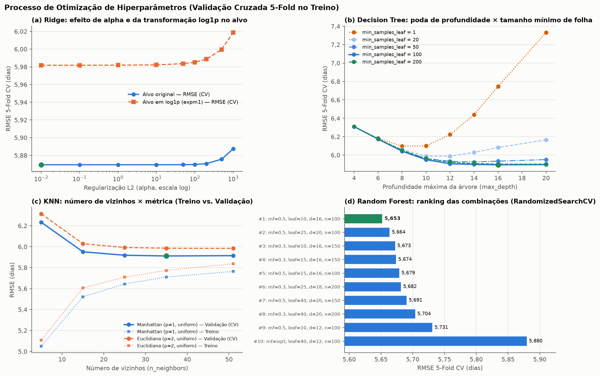
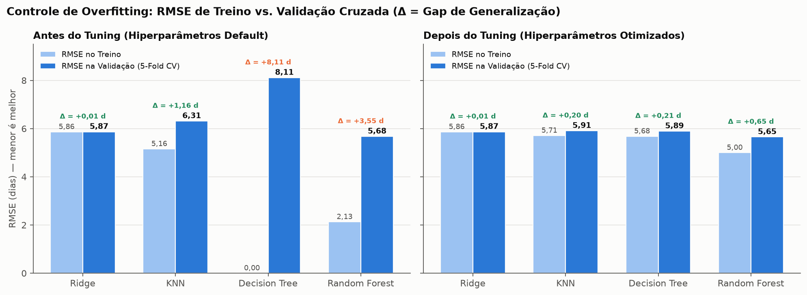
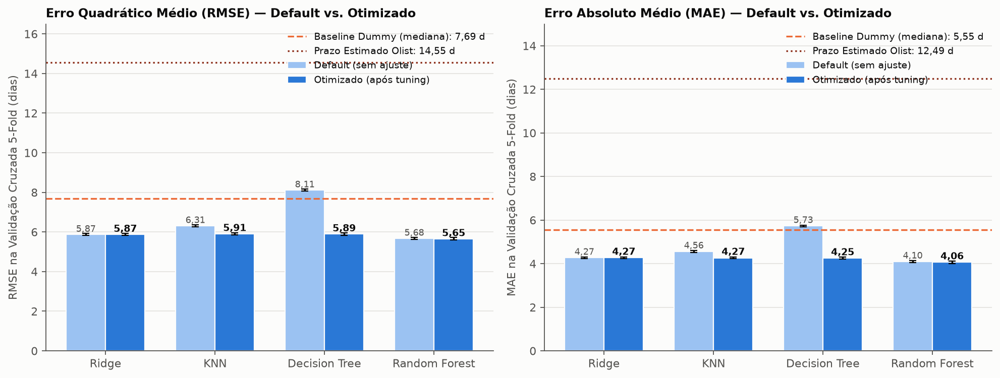
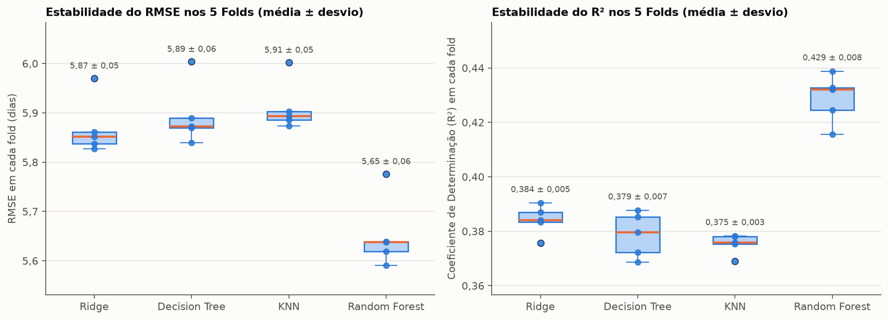
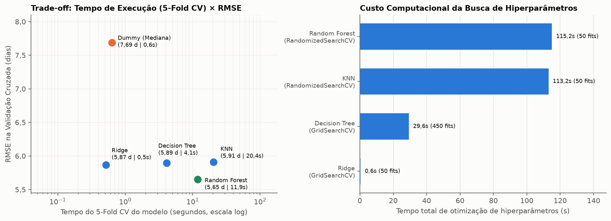
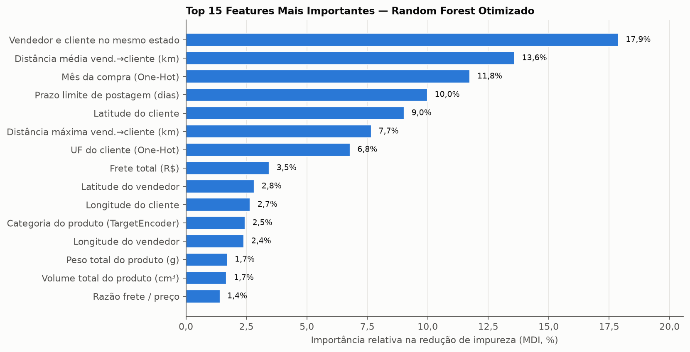
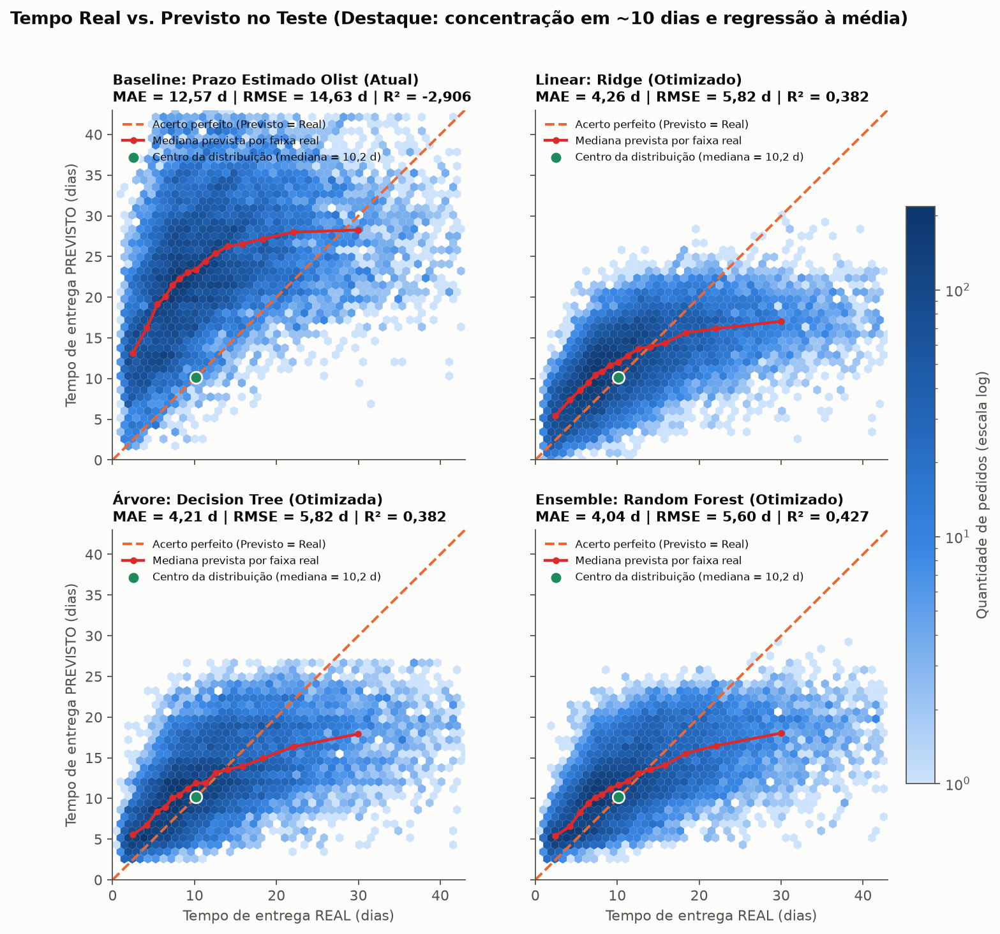
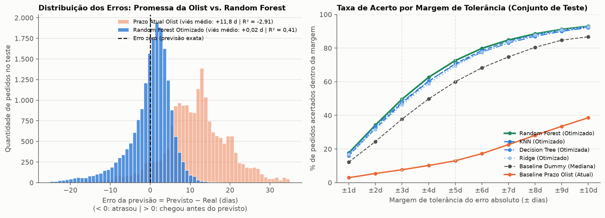
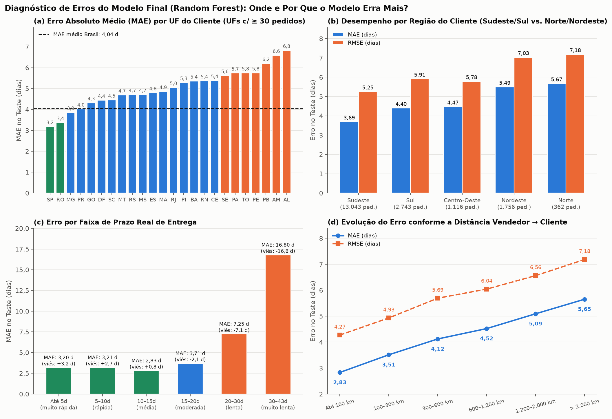

# Parte 4 — Treinamento e Resultados dos Modelos

Este documento resume o treinamento, o ajuste de hiperparâmetros e a análise detalhada dos resultados na previsão do tempo de entrega dos pedidos da Olist.

---

## 1. Divisão dos Dados, Cuidados de Limpeza e Validação Cruzada

Partimos da base limpa com **95.100 pedidos entregues** e **26 variáveis de entrada** (que se tornam **64 colunas** após as codificações).

- **Retirada do `prazo_estimado_dias` das features de entrada:**
  - Como o objetivo do nosso modelo é **substituir/melhorar a estimativa de prazo da Olist**, retiramos o `prazo_estimado_dias` das variáveis que alimentam os modelos. Ele é mantido separadamente **apenas como Baseline de comparação**.
- **Tratamento do outlier em `prazo_postagem_dias`:**
  - Os 187 pedidos que tinham erro de cadastro no prazo limite de postagem (acima de 30 dias, chegando a 1.052 dias) foram tratados como ausentes e imputados pela mediana do treino, evitando distorções nos modelos lineares.
- **Divisão Treino e Teste (80% / 20%):**
  - **Treino:** **76.080 pedidos** — usados para treinar os modelos e buscar os melhores hiperparâmetros.
  - **Teste:** **19.020 pedidos** — separados desde o início e usados apenas no final para avaliar o desempenho em dados inéditos.
- **Validação Cruzada de 5 Folds (`5-Fold Cross-Validation`):**
  - Dentro dos 76.080 pedidos de treino, dividimos os dados em 5 partes iguais (~15.216 pedidos cada). Cada modelo foi treinado e validado 5 vezes em partes diferentes para garantir consistência.

---

## 2. Modelos Implementados (4 Famílias + 2 Baselines)

| Categoria | Modelo | Como ele funciona |
|---|---|---|
| **Baseline de Negócio** | **Prazo Estimado da Olist** | É o prazo que a própria Olist promete hoje para o cliente no checkout (avaliado como referência externa). |
| **Baseline Estatístico** | **Dummy (Mediana)** | Um chute fixo que prevê sempre a mediana dos pedidos de treino (**10,1 dias**). |
| **1. Modelo Linear** | **Ridge** | Soma as variáveis com pesos lineares e aplica regularização ($L_2$) para controlar variáveis colineares (como distância média e máxima). |
| **2. Árvore de Decisão** | **Decision Tree** | Cria regras de decisão em formato de árvore (ex.: *mesmo estado = não e distância > 500 km*), capturando relações não lineares. |
| **3. Baseado em Instâncias** | **KNN** | Busca os $k$ pedidos passados mais parecidos (em distância, frete, região) e tira a média simples (`weights="uniform"`) do tempo de entrega deles. |
| **4. Ensemble (Comitê)** | **Random Forest** | Treina 100 árvores de decisão independentes ao mesmo tempo e combina a resposta de todas para reduzir o erro. |

---

## 3. Ajuste de Hiperparâmetros (`GridSearchCV` e `RandomizedSearchCV`)

Usamos **`GridSearchCV`** nos modelos rápidos (`Ridge` e `Decision Tree`) e **`RandomizedSearchCV`** nos modelos mais pesados (`KNN` e `Random Forest`):

| Modelo | Método Usado | Melhor Configuração Encontrada | RMSE Validação (Antes → Depois) |
|---|---|---|---:|
| **Ridge** | `GridSearchCV` | Regularização `alpha = 10` (mantendo o alvo na escala original em dias) | 5,87 d → **5,87 d** |
| **Decision Tree** | `GridSearchCV` | Profundidade máxima `max_depth = 16` e mínimo de `100` pedidos por folha (`min_samples_leaf = 100`) | 8,11 d → **5,90 d** |
| **KNN** | `RandomizedSearchCV` | `35` vizinhos (`n_neighbors = 35`), distância de **Manhattan ($p=1$)** e média uniforme (`weights = "uniform"`) | 6,31 d → **5,91 d** |
| **Random Forest** | `RandomizedSearchCV` | `100` árvores, profundidade `16`, folha mínima `10`, quebra mínima `20` e sorteio de `50%` das colunas (`max_features = 0.5`) | 5,68 d → **5,65 d** |

- **(a) Ridge:** Testamos prever o alvo em logaritmo (`log1p`, linha laranja), mas manter o alvo em dias originais (linha azul) teve menor RMSE (**5,87 dias** contra 5,98 dias).
- **(b) Decision Tree:** Sem limite (`min_samples_leaf = 1`, linha laranja), o erro sobe conforme a árvore aprofunda porque ela decora o treino. Limitando para 100 pedidos por folha e profundidade 16 (linha azul), o erro cai **2,22 dias**.
- **(c) KNN:** Com `weights="uniform"` e distância de Manhattan ($p=1$), à medida que aumentamos os vizinhos de 5 para 35, as curvas de treino (pontilhada) e validação (contínua) se aproximam sem decorar os dados, baixando o erro para **5,91 dias**.
- **(d) Random Forest:** A barra verde no topo mostra a melhor combinação encontrada pelo `RandomizedSearchCV`, atingindo **5,65 dias** de RMSE.

---

## 4. Verificação e Controle de Overfitting (Nenhum Modelo Otimizado tem RMSE = 0)

Comparando o erro nos dados de **treino** (barra azul-clara) com o erro na **validação cruzada** (barra azul-escura), verificamos que o ajuste de hiperparâmetros eliminou o *overfitting*:

- **Por que a Decision Tree tinha `RMSE = 0,00` antes do tuning (esquerda)?** Porque na configuração padrão do `scikit-learn` (`max_depth=None, min_samples_leaf=1`), a árvore se divide até criar uma folha individual para cada pedido de treino (decorando 100% do treino com erro zero, mas errando **8,11 dias** na validação).
- **Por que usamos `weights="uniform"` no KNN?** Quando se usa ponderação pelo inverso da distância (`weights="distance"`), a distância de um ponto do treino para ele mesmo é zero (peso infinito), o que gera artificialmente `RMSE = 0,00` no treino. Com `weights="uniform"`, o KNN tira a média simples dos 35 vizinhos, mantendo o erro de treino em **5,71 dias** e o de validação em **5,91 dias** ($\Delta = +0,20\text{ d}$).
- **Resultado após o tuning (direita):** **Nenhum modelo otimizado tem RMSE = 0**. Todos têm erro de treino muito próximo ao erro de validação ($\Delta$ entre `+0,01 d` e `+0,65 d`).

---

## 5. Comparativo Geral na Validação Cruzada e Estabilidade

- Todos os 4 modelos otimizados superam com folga os dois baselines, e o **Random Forest Otimizado** lidera tanto em RMSE (**5,65 dias**) quanto em MAE (**4,06 dias**).
- A variação entre os 5 folds é de apenas **~0,05 dia** (~1 hora), demonstrando alta estabilidade.

---

## 6. Tempo de Execução e Variáveis Mais Importantes

O **Random Forest** se apoia diretamente nas variáveis logísticas, geográficas e temporais do pedido:
1. **Vendedor e cliente no mesmo estado (`mesmo_estado`):** **17,9%**
2. **Distância vendedor→cliente (`distancia_media_km` + `distancia_max_km`):** **21,3%** somadas (13,6% + 7,7%)
3. **Mês da compra (`compra_mes`):** **11,8%** (sazonalidade e gargalos de fim de ano/Black Friday)
4. **Prazo limite de postagem do lojista (`prazo_postagem_dias`):** **10,0%**
5. **Localização do cliente (`cliente_lat` + `cliente_estado` + `cliente_lng`):** **18,5%** somadas (9,0% + 6,8% + 2,7%)
6. **Frete total (`frete_total`):** **3,5%**

---

## 7. Resultados no Conjunto de Teste e Explicação do $R^2 = -2,91$ da Olist

Avaliamos os modelos já otimizados nos **19.020 pedidos inéditos do conjunto de teste**:

| Posição | Modelo | MAE (Erro Médio) | RMSE | Erro Mediano | $R^2$ | Viés Médio | Pedidos c/ erro ≤ 3 dias | Pedidos c/ erro ≤ 5 dias |
|---:|---|---:|---:|---:|---:|---:|---:|---:|
| **1º** | **Random Forest (Otimizado)** | **4,04 dias** | **5,60 dias** | **3,02 dias** | **0,427** | +0,02 d | **49,6%** | **72,6%** |
| 2º | **Decision Tree (Otimizada)** | 4,21 dias | 5,82 dias | 3,14 dias | 0,383 | +0,01 d | 48,0% | 70,3% |
| 3º | **Ridge (Otimizado)** | 4,26 dias | 5,82 dias | 3,29 dias | 0,382 | +0,03 d | 46,2% | 69,3% |
| 4º | **KNN (Otimizado)** | 4,23 dias | 5,85 dias | 3,20 dias | 0,377 | −0,09 d | 47,3% | 70,8% |
| 5º | *Baseline Dummy (Mediana)* | *5,49 dias* | *7,63 dias* | *4,01 dias* | *-0,060* | *-1,82 d* | *37,8%* | *60,0%* |
| 6º | *Prazo Estimado da Olist (Atual)* | *12,57 dias* | *14,63 dias* | *12,17 dias* | ***-2,906*** | *+11,81 d* | *7,7%* | *13,0%* |

### Por que o $R^2$ do `Prazo Estimado da Olist` é negativo (`-2,906`)?
- O $R^2$ compara o erro quadrático médio do modelo ($\text{MSE}$) com a variância natural dos dados ($\text{Var}(y)$) pela fórmula:
  $$R^2 = 1 - \frac{\text{MSE do modelo}}{\text{Variância do alvo}}$$
- Se um modelo chutar sempre a **média real das entregas (11,9 dias)**, o erro quadrático dele é igual à variância dos dados ($54,8\text{ dias}^2$) e o **$R^2$ vale `0,00`**.
- Já o **Prazo Estimado da Olist** não prevê a média real: a Olist joga uma **folga de segurança de +11,81 dias para cima** (promete em média ~23,7 dias para entregas que levam ~11,9 dias) para evitar que o pedido pareça atrasado.
- Isso faz o erro quadrático da Olist ($\text{MSE} = 14,63^2 = 214,2\text{ dias}^2$) ser **quase 4 vezes maior** do que a variância dos dados ($214,2 / 54,8 = 3,906$), resultando em $R^2 = 1 - 3,906 = \mathbf{-2,906}$.

---

## 8. Análise do Ponto Médio (~10 dias) na Distribuição Real × Previsto

Observando os gráficos **Real × Previsto** (acima), destacam-se dois comportamentos importantes:
1. **Forte concentração em torno do ponto médio de ~10,2 dias (ponto verde):**
   - Mais de 70% dos pedidos da Olist ocorrem na região Sudeste/Sul e são entregues entre **5 e 15 dias** (mediana real = **10,2 dias**). Nessa região central onde está a maioria dos pedidos, a curva vermelha (mediana prevista pelos nossos modelos) acompanha de perto a linha tracejada de acerto perfeito.
2. **Por que a curva vermelha "achata" para entregas reais acima de 20 dias?**
   - Quando um pedido demora de 25 a 42 dias para chegar, na maioria das vezes isso aconteceu por **imprevistos após a compra** (atrasos internos dos Correios/transportadora, greves ou extravios temporários) — informações que não existem no momento do checkout.
   - Como o modelo só enxerga os dados do momento da compra, para uma rota longa ele prevê o tempo típico daquela rota (**16 a 22 dias**), subestimando os atrasos anômalos.

---

## 9. Onde o Modelo Erra Mais? (Análise por Estado, Região, Prazo e Distância)

Para descobrir exatamente onde o **Random Forest** acerta mais e onde ele tem maior dificuldade, abrimos o erro do conjunto de teste por **UF**, **Região**, **Faixa de Prazo Real** e **Distância**:

1. **Estados (UFs) que erram menos vs. Estados que erram mais — Painel (a):**
   - **Onde o modelo erra menos:** **São Paulo (MAE = 3,18 dias**, acertando **83,5%** dos pedidos em até ±5 dias), **Minas Gerais (3,86 d)** e **Paraná (4,02 d)**. São estados com rotas curtas, muitos vendedores locais e grande volume de exemplos no treinamento.
   - **Onde o modelo erra mais:** Estados do Norte e Nordeste como **Alagoas (6,83 d)**, **Amazonas (6,59 d)**, **Paraíba (6,20 d)**, **Pernambuco (5,75 d)**, **Tocantins (5,75 d)** e **Pará (5,74 d)**, devido às longas distâncias (vendedores concentrados em SP) e maior variação nas rotas de transporte.
   - **Caso especial no Sudeste — Rio de Janeiro (RJ):** O RJ apresenta **MAE de 5,05 dias** (bem maior que SP `3,18 d` e MG `3,86 d`), pois historicamente sofre com alta variabilidade de prazos de entrega e restrições logísticas nas áreas urbanas.
2. **Erro por Região — Painel (b):**
   - O erro médio sobe gradualmente conforme nos afastamos do eixo de vendedores (Sudeste): **Sudeste (3,69 d)** $\rightarrow$ **Sul (4,40 d)** $\rightarrow$ **Centro-Oeste (4,47 d)** $\rightarrow$ **Nordeste (5,49 d)** $\rightarrow$ **Norte (5,67 d)**.
3. **Erro por Faixa de Prazo Real — Painel (c):**
   - Para entregas de **até 15 dias** (que somam **14.066 dos 19.020 pedidos do teste = 74% da base**), o modelo erra muito pouco (**MAE entre 2,83 e 3,21 dias**).
   - O erro alto concentra-se na pequena parcela de pedidos que sofreram grandes atrasos (**20–30 dias: MAE = 7,25 d**; **30–43 dias: MAE = 16,80 d**, apenas 3,3% da base).
4. **Erro por Distância — Painel (d):**
   - Em entregas locais (**até 100 km**), o MAE é de apenas **2,83 dias**, crescendo de forma quase linear até **5,65 dias** para rotas acima de **2.000 km**.
