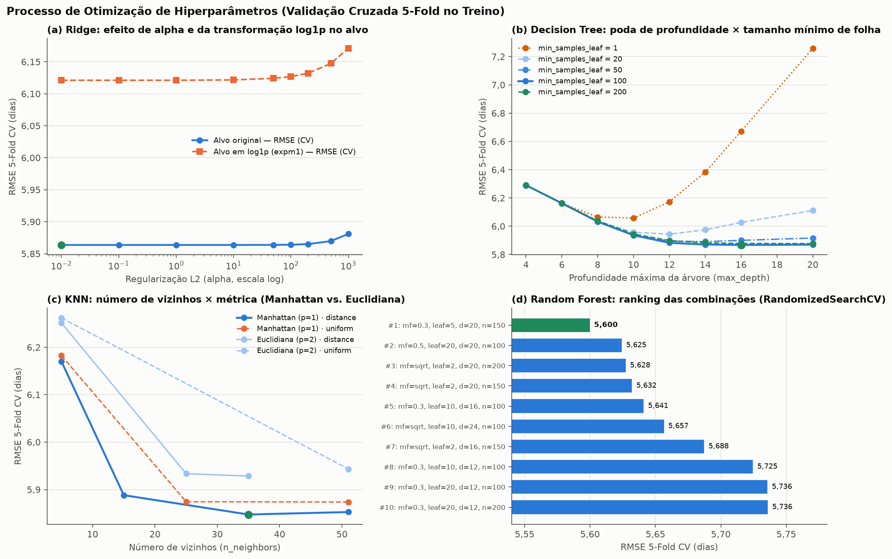
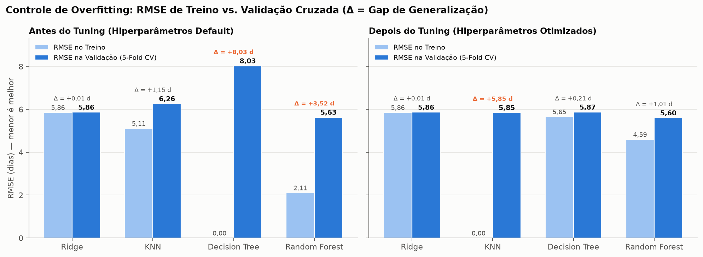
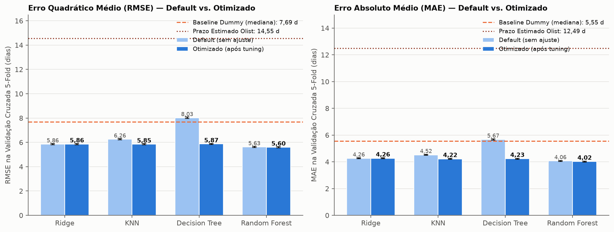
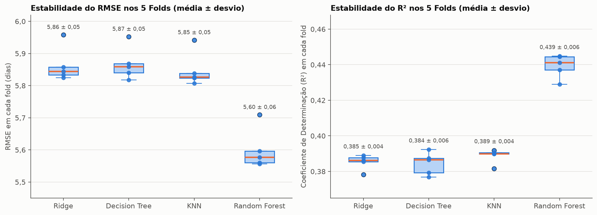
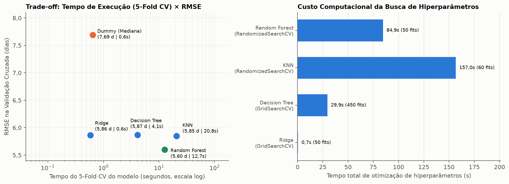
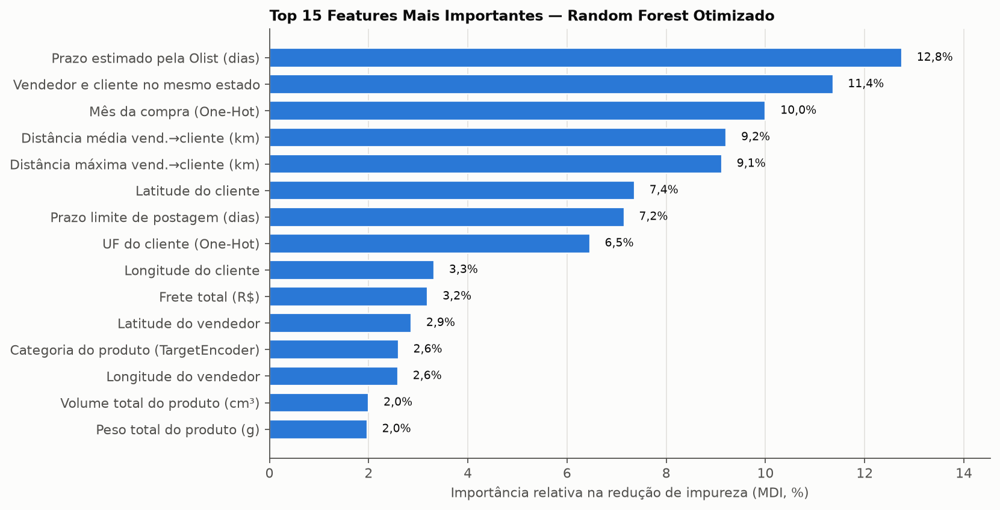
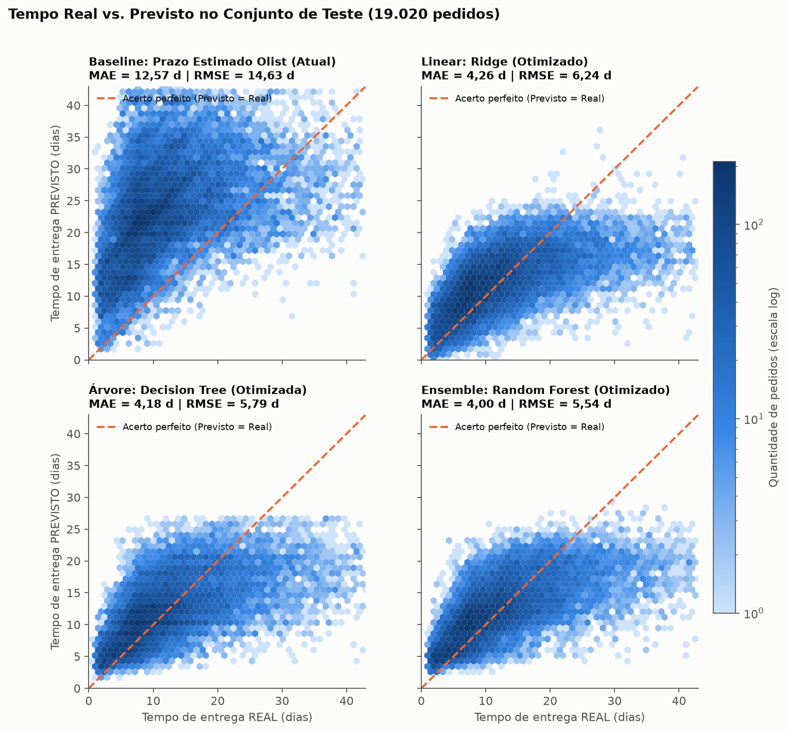
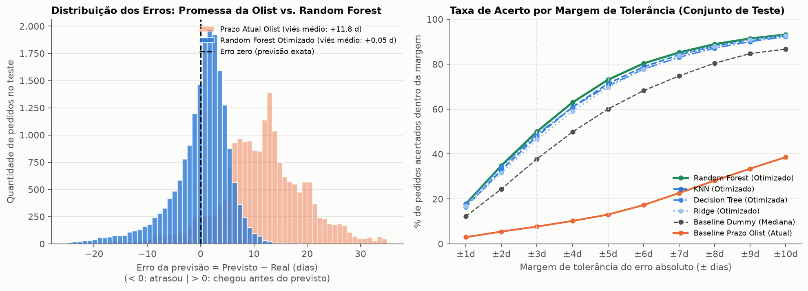

# Parte 4 — Treinamento e Resultados dos Modelos

Este documento resume o treinamento, o ajuste de hiperparâmetros e os resultados obtidos na previsão do tempo de entrega dos pedidos da Olist.

---

## 1. Divisão dos Dados e Validação Cruzada

Partimos da base limpa construída no pré-processamento com **95.100 pedidos entregues** e **27 variáveis** (que se tornam **65 colunas** após as codificações).

- **Divisão Treino e Teste (80% / 20%):**
  - **Treino:** **76.080 pedidos** — usados para treinar os modelos e buscar os melhores hiperparâmetros.
  - **Teste:** **19.020 pedidos** — separados desde o início e usados apenas no final para avaliar o desempenho em dados inéditos.
- **Validação Cruzada de 5 Folds (`5-Fold Cross-Validation`):**
  - Dentro dos 76.080 pedidos de treino, dividimos os dados em 5 partes iguais (~15.216 pedidos cada).
  - Cada modelo foi treinado 5 vezes (sempre usando 4 partes para treinar e 1 parte para validar). Assim garantimos que o resultado é consistente e não depende de sorte na divisão dos dados.
- **Métricas utilizadas:**
  - **MAE (Erro Absoluto Médio):** quantos dias, em média, o modelo erra para mais ou para menos *(quanto menor, melhor)*.
  - **RMSE (Raiz do Erro Quadrático Médio):** parecido com o MAE, mas penaliza mais erros muito grandes *(quanto menor, melhor)*.
  - **$R^2$ (Coeficiente de Determinação):** proporção da variação do tempo de entrega que o modelo consegue explicar *(quanto mais próximo de 1, melhor)*.

---

## 2. Modelos Implementados

Implementamos **4 modelos de famílias diferentes** (cobrindo todas as opções pedidas no trabalho) e **2 linhas de base (baselines)** para ter uma referência justa de comparação:

| Categoria | Modelo | Como ele funciona |
|---|---|---|
| **Baseline de Negócio** | **Prazo Estimado da Olist** | É o prazo que a própria Olist promete hoje para o cliente na hora da compra. |
| **Baseline Estatístico** | **Dummy (Mediana)** | Um chute fixo que prevê sempre a mediana dos pedidos de treino (**10,1 dias**). |
| **1. Modelo Linear** | **Ridge** | Soma as variáveis com pesos lineares e aplica uma regularização ($L_2$) para evitar que variáveis parecidas (como distância média e máxima) distorçam o modelo. |
| **2. Árvore de Decisão** | **Decision Tree** | Cria regras de decisão em formato de árvore (ex.: *distância > 500 km e região = Norte*), capturando relações que não são lineares. |
| **3. Baseado em Instâncias** | **KNN** | Para prever um pedido novo, busca os $k$ pedidos passados mais parecidos (em distância, frete, região) e calcula a média ponderada do tempo de entrega deles. |
| **4. Ensemble (Comitê)** | **Random Forest** | Treina várias árvores de decisão independentes ao mesmo tempo e combina a resposta de todas para reduzir o erro. |

---

## 3. Ajuste de Hiperparâmetros (`GridSearchCV` e `RandomizedSearchCV`)

Para descobrir a melhor configuração de cada modelo dentro da validação cruzada, usamos **`GridSearchCV`** nos modelos de treino rápido (`Ridge` e `Decision Tree`) e **`RandomizedSearchCV`** nos modelos mais pesados (`KNN` e `Random Forest`).

| Modelo | Método Usado | O que foi ajustado (Melhor Configuração Encontrada) | RMSE Antes → Depois |
|---|---|---|---:|
| **Ridge** | `GridSearchCV` | Força da regularização `alpha = 10` (mantendo o alvo na escala original em dias) | 5,86 d → **5,86 d** |
| **Decision Tree** | `GridSearchCV` | Profundidade máxima `max_depth = 16` e mínimo de `100` pedidos por folha (`min_samples_leaf = 100`) | 8,03 d → **5,87 d** |
| **KNN** | `RandomizedSearchCV` | `35` vizinhos (`n_neighbors = 35`), distância de **Manhattan ($p=1$)** e peso pela proximidade (`weights = "distance"`) | 6,26 d → **5,85 d** |
| **Random Forest** | `RandomizedSearchCV` | `150` árvores, profundidade `20`, folha mínima `5` e sorteio de `30%` das colunas a cada divisão (`max_features = 0.3`) | 5,63 d → **5,60 d** |

Abaixo vemos o efeito prático dos hiperparâmetros no erro de validação de cada modelo:

- **(a) Ridge:** Testamos prever o alvo em logaritmo (`log1p`, linha laranja) como sugerido na EDA, mas manter o alvo em dias originais (linha azul) teve menor RMSE (**5,86 dias** contra 6,12 dias).
- **(b) Decision Tree:** Sem limite (linha laranja pontilhada, `min_samples_leaf = 1`), quanto mais profunda a árvore fica, mais o erro sobe porque ela decora o treino. Limitando para 100 pedidos por folha e profundidade 16 (linha azul contínua), o erro cai mais de 2 dias.
- **(c) KNN:** Aumentar para 35 vizinhos e usar a distância de Manhattan ($p=1$, linha azul escura) reduziu bastante o erro em relação ao KNN padrão de 5 vizinhos (de 6,26 para **5,85 dias**).
- **(d) Random Forest:** A barra verde no topo mostra a melhor combinação encontrada pelo `RandomizedSearchCV`, atingindo **5,60 dias** de RMSE.

---

## 4. Como o Ajuste Eliminou o Overfitting

Comparando o erro nos dados de **treino** (barra azul-clara) com o erro na **validação cruzada** (barra azul-escura), fica claro o impacto do ajuste de hiperparâmetros:

- **Antes do ajuste (esquerda):** A **Decision Tree** padrão decorou 100% dos dados de treino (erro `0,00` no treino), mas teve o pior erro na validação (**8,03 dias**, pior até que o chute fixo na mediana). O **Random Forest** padrão também tinha uma diferença grande entre treino (`2,11` d) e validação (`5,63` d).
- **Depois do ajuste (direita):** Na **Decision Tree**, o erro no treino (`5,65` d) e na validação (`5,87` d) ficaram quase idênticos (diferença de apenas `0,21` dia). No **Random Forest**, a diferença entre treino e validação caiu de `3,52` para apenas `1,01` dia, e o erro de validação melhorou para **5,60 dias**.

---

## 5. Comparativo dos Modelos na Validação Cruzada (Treino)

O gráfico abaixo compara o erro de todos os modelos (antes e depois do ajuste) frente aos dois baselines:

- A **linha pontilhada marrom** no topo é o prazo que a Olist promete hoje: erra em média **12,49 dias (MAE)** e **14,55 dias (RMSE)**.
- A **linha tracejada laranja** é o chute fixo na mediana: erra **5,55 dias (MAE)** e **7,69 dias (RMSE)**.
- Todos os 4 modelos otimizados superam com folga as linhas de base, e o **Random Forest Otimizado** obtém o menor erro tanto em RMSE (**5,60 dias**) quanto em MAE (**4,02 dias**).

Além disso, olhando os 5 folds separadamente, vemos que os modelos são muito estáveis (a variação entre um fold e outro é de apenas ~0,05 dia):

---

## 6. Tempo de Execução e Variáveis Mais Importantes

Analisamos também o tempo gasto por cada modelo e quais variáveis o **Random Forest** mais utilizou para tomar decisão:

- **Custo computacional:** O **Ridge** é quase instantâneo (`0,6s`), sendo ótimo como modelo rápido. O **KNN** é o mais lento (`157s` na busca) porque precisa medir a distância de cada pedido novo contra 76 mil pedidos antigos. O **Random Forest** entrega o menor erro com tempo de validação enxuto (`12,7s`).

- **O que mais importa para prever a entrega:** As variáveis logísticas e geográficas concentram cerca de **75% da importância** do modelo: **distância vendedor–cliente** (somando média e máxima dá **18,3%**), **prazo estimado pela Olist** (**12,8%**), **vendedor e cliente no mesmo estado** (**11,4%**), **mês da compra** (**10,0%**) e **localização/UF do cliente**. Já peso, volume e preço do produto pesam ~2% cada — confirmando o que vimos na etapa de EDA.

---

## 7. Resultados no Conjunto de Teste (19.020 Pedidos Inéditos)

Por fim, avaliamos os modelos já otimizados nos **19.020 pedidos do conjunto de teste** (que não participaram do treinamento nem do ajuste de hiperparâmetros):

| Posição | Modelo | MAE (Erro Médio) | RMSE | Erro Mediano | $R^2$ | Pedidos c/ erro ≤ 3 dias | Pedidos c/ erro ≤ 5 dias |
|---:|---|---:|---:|---:|---:|---:|---:|
| **1º** | **Random Forest (Otimizado)** | **4,00 dias** | **5,54 dias** | **3,00 dias** | **0,440** | **50,0%** | **73,1%** |
| 2º | **KNN (Otimizado)** | 4,18 dias | 5,78 dias | 3,15 dias | 0,391 | 47,9% | 71,4% |
| 3º | **Decision Tree (Otimizada)** | 4,18 dias | 5,79 dias | 3,10 dias | 0,388 | 48,8% | 70,4% |
| 4º | **Ridge (Otimizado)** | 4,26 dias | 6,24 dias* | 3,27 dias | 0,290 | 46,3% | 69,5% |
| 5º | *Baseline Dummy (Mediana)* | *5,49 dias* | *7,63 dias* | *4,01 dias* | *-0,060* | *37,8%* | *60,0%* |
| 6º | *Prazo Estimado da Olist (Atual)* | *12,57 dias* | *14,63 dias* | *12,17 dias* | *-2,906* | *7,7%* | *13,0%* |

*\*Observação sobre o Ridge no teste: no conjunto de teste existe 1 pedido com erro de cadastro no prazo de postagem (1.052 dias, apontado na EDA). Por ser linear, o Ridge previu 332 dias para esse único pedido, subindo seu RMSE de 5,86 para 6,24 dias, enquanto Decision Tree, KNN e Random Forest não foram afetados.*

Os dois gráficos abaixo mostram visualmente o ganho do modelo em relação à estimativa atual da Olist nos pedidos de teste:

- **Real vs. Previsto (acima):** No primeiro quadro, a nuvem da **Olist** fica toda acima da linha tracejada porque a empresa promete prazos com folga exagerada (em média ~12 dias a mais do que o real). Já os nossos modelos — especialmente o **Random Forest** (quadro inferior direito) — concentram as previsões em cima da linha tracejada de acerto.

- **Distribuição dos erros e margem de acerto (acima):**
  - No **histograma à esquerda**, vemos que o erro da Olist (em laranja) fica deslocado em **+11,8 dias**, enquanto o erro do **Random Forest** (em azul) fica centrado exatamente no **zero** (`+0,05` dia).
  - Na **curva à direita**, vemos que o **Random Forest acerta metade de todos os pedidos (50,0%) errando no máximo 3 dias** e **73,1% errando no máximo 5 dias** (contra apenas **7,7%** e **13,0%** da estimativa atual da Olist), reduzindo o erro médio da empresa em **68%** (de **12,57 dias** para **4,00 dias**).
