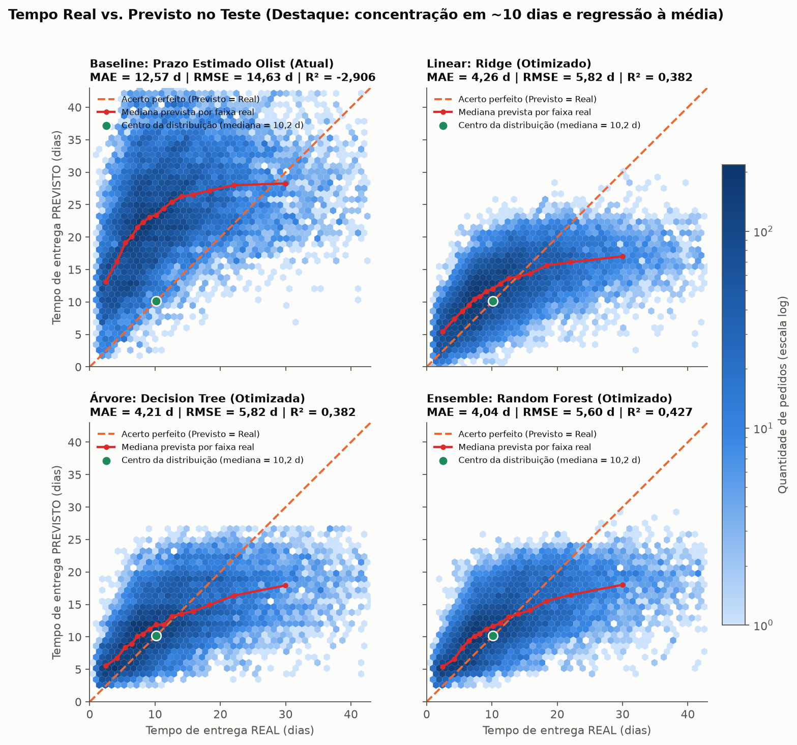
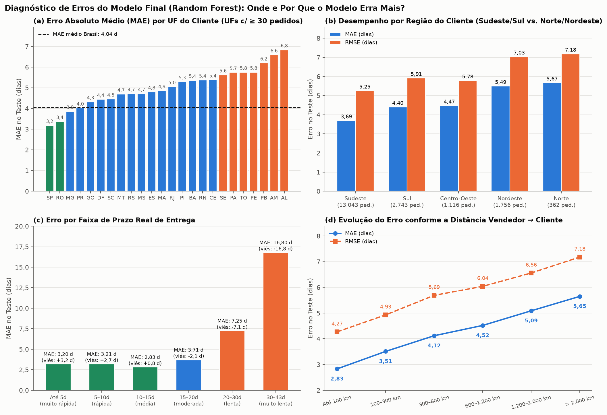

# 5. Avaliação do Modelo e Conclusão

Esta etapa avalia a capacidade dos modelos de prever o tempo de entrega dos pedidos da Olist, compara seus desempenhos em dados não utilizados durante o treinamento, investiga em quais regiões/estados o modelo erra mais e justifica a escolha do modelo final. A avaliação utiliza os resultados registrados em [`docs/figures/04_treinamento/tabelas/4_resultados_parciais_teste.csv`](figures/04_treinamento/tabelas/4_resultados_parciais_teste.csv).

### 5.1. Protocolo de avaliação

A avaliação final foi realizada sobre o conjunto de teste, composto por **19.020 pedidos (20% da base)**. Esses registros foram separados antes do treinamento e não participaram do ajuste dos hiperparâmetros. Os modelos avaliados são as versões otimizadas de **Ridge**, **Decision Tree**, **KNN** e **Random Forest** — todos treinados **sem utilizar o `prazo_estimado_dias` da Olist como feature de entrada**, garantindo independência em relação à estimativa atual da empresa. Também foram incluídos dois baselines: a mediana do tempo de entrega observada no conjunto de treino (**10,1 dias**) e o prazo estimado informado pela Olist.

A seleção e o ajuste dos modelos foram conduzidos anteriormente por validação cruzada de cinco folds, restrita ao conjunto de treino, com controle explícito de *overfitting* (nenhum modelo otimizado apresenta memorização ou `RMSE = 0` no treino).

### 5.2. Métricas utilizadas

Foram utilizadas três métricas principais de regressão:

- **MAE:** calcula a média dos valores absolutos das diferenças entre o tempo real e o previsto. É expresso em dias e representa o tamanho médio do erro, sem considerar sua direção. Quanto menor, melhor.
- **RMSE:** calcula a raiz da média dos erros ao quadrado. Também é expresso em dias, mas penaliza mais fortemente erros de grande magnitude. Quanto menor, melhor.
- **R²:** indica quanto da variabilidade do tempo real de entrega é explicada pelas previsões do modelo ($R^2 = 1 - \frac{\text{MSE}_{\text{modelo}}}{\text{Var}(y)}$). Quanto mais próximo de 1, melhor. Um valor negativo indica que o erro quadrático médio do método é superior à variância natural dos dados (isto é, erra mais do que um preditor constante baseado na média do alvo).

Como métricas complementares, também foram registrados o **MedAE** (erro absoluto mediano), o viés médio das previsões e o percentual de pedidos em que a previsão ficou a até três ou cinco dias do valor real.

### 5.3. Benchmark dos modelos no conjunto de teste

A tabela apresenta os resultados dos seis métodos avaliados nos 19.020 pedidos de teste:

| Modelo                      | MAE (dias) | RMSE (dias) |        R² | Erro mediano (dias) | Erro até 3 dias | Erro até 5 dias |
| --------------------------- | ---------: | ----------: | --------: | ------------------: | --------------: | --------------: |
| **Random Forest otimizado** |   **4,04** |    **5,60** | **0,427** |            **3,02** |      **49,63%** |      **72,58%** |
| Decision Tree otimizada     |       4,21 |        5,82 |     0,383 |                3,14 |          48,00% |          70,29% |
| Ridge otimizado             |       4,26 |        5,82 |     0,382 |                3,29 |          46,16% |          69,34% |
| KNN otimizado               |       4,23 |        5,85 |     0,377 |                3,20 |          47,32% |          70,75% |
| Dummy (mediana)             |       5,49 |        7,63 |    -0,060 |                4,01 |          37,81% |          60,02% |
| Prazo estimado da Olist     |      12,57 |       14,63 |    -2,906 |               12,17 |           7,67% |          13,01% |

O **Random Forest otimizado apresentou o melhor desempenho geral**: obteve o menor MAE (**4,04 dias**), o menor RMSE (**5,60 dias**) e o maior R² (**0,427**) entre todos os métodos avaliados, mesmo sem utilizar a estimativa da Olist como variável de entrada. Seu erro absoluto mediano foi de **3,02 dias**, com **49,63%** das previsões a até três dias do valor real e **72,58%** a até cinco dias.

#### Por que o `Prazo estimado da Olist` apresenta $R^2 = -2,906$?
Pela fórmula $R^2 = 1 - \frac{\text{MSE}_{\text{modelo}}}{\text{Var}(y_{\text{real}})}$, um modelo que prevê sempre a média real do teste (~11,9 dias) possui erro quadrático médio igual à variância do alvo ($\sigma_y^2 \approx 54,8\text{ dias}^2$) e, portanto, $R^2 = 0$. Já o prazo estimado da Olist não busca prever o tempo médio real: trata-se de um prazo conservador que embute uma **folga média de +11,81 dias** acima do tempo real para evitar atrasos percebidos pelo consumidor. Essa superestimação sistemática gera um $\text{RMSE} = 14,63\text{ dias}$ ($\text{MSE} = 14,63^2 \approx 214,2\text{ dias}^2$, quase 4 vezes maior que a variância do alvo), resultando em $R^2 = 1 - \frac{214,2}{54,8} = \mathbf{-2,906}$.

### 5.4. Justificativa da escolha do modelo final

O **Random Forest otimizado foi selecionado como modelo final** por apresentar a melhor combinação em todas as métricas avaliadas. Em relação aos modelos de árvore única (Decision Tree), linear (Ridge) e baseado em vizinhos (KNN), reduziu o MAE de ~4,21–4,26 para **4,04 dias** e o RMSE de ~5,82–5,85 para **5,60 dias**, elevando o $R^2$ de ~0,38 para **0,427**.

A escolha também é sustentada pela validação cruzada de cinco folds realizada no conjunto de treino. Nessa etapa, o Random Forest otimizado obteve RMSE médio de **5,6525 ± 0,0580 dias**, MAE médio de **4,0624 dias** e R² médio de **0,4288**. No conjunto de teste, os resultados foram RMSE de **5,6041 dias**, MAE de **4,0401 dias** e R² de **0,4273**. A proximidade entre validação cruzada e teste confirma a consistência de generalização do modelo.

Além disso, após o tratamento no pré-processamento dos erros de cadastro em `prazo_postagem_dias` (> 30 dias, que chegavam a 1.052 dias), o modelo linear **Ridge** também passou a apresentar comportamento estável no teste (RMSE de **5,82 dias**, alinhado aos **5,87 dias** da validação cruzada).

Em comparação com o prazo estimado da Olist, o Random Forest reduziu o MAE de **12,57 para 4,04 dias** — uma redução de **67,9% no erro absoluto médio**.

### 5.5. Análise dos resultados, comportamento em ~10 dias e diagnóstico de onde o modelo erra mais





1. **Concentração no ponto médio (~10,2 dias) e achatamento em entregas muito longas:**
   - No gráfico *Real × Previsto*, a maior densidade de pontos concentra-se em torno de **10,2 dias** (mediana real das entregas), pois ~83% dos pedidos ocorrem no Sudeste e Sul, onde os prazos reais variam majoritariamente entre 5 e 15 dias. Nessa faixa central (74% dos pedidos do teste), a mediana prevista acompanha de perto a diagonal ideal e o MAE do modelo é baixo (**2,83 a 3,21 dias**).
   - Para entregas reais acima de **20 dias** (especialmente na faixa de 30 a 43 dias, que representa 3,3% do teste), a curva prevista estabiliza em torno de **16 a 22 dias** (MAE de **7,25 d** na faixa 20–30d e **16,80 d** na faixa 30–43d). Isso ocorre porque atrasos extremos costumam decorrer de fatores pós-compra não observáveis no momento do pedido (extravios temporários, greves, retenção fiscal ou falhas operacionais na transportadora).

2. **Estados (UFs) e Regiões onde o modelo erra mais ([`6_erro_por_uf.csv`](figures/04_treinamento/tabelas/6_erro_por_uf.csv) e [`7_erro_por_regiao.csv`](figures/04_treinamento/tabelas/7_erro_por_regiao.csv)):**
   - **Sudeste (MAE = 3,69 d | 77,5% até ±5d):** menor erro do país, puxado por **SP (MAE = 3,18 d**, onde 83,5% dos pedidos têm erro ≤ 5 dias) e **MG (3,86 d)**. A exceção dentro do Sudeste é o **RJ (MAE = 5,05 d)**, que apresenta alta variabilidade logística mesmo próximo a SP.
   - **Sul (MAE = 4,40 d) e Centro-Oeste (MAE = 4,47 d):** desempenho intermediário (**PR = 4,02 d**, **GO = 4,32 d**, **DF = 4,44 d**, **SC = 4,45 d**, **RS = 4,71 d**).
   - **Nordeste (MAE = 5,49 d) e Norte (MAE = 5,67 d):** regiões onde o modelo mais erra, com destaque para **AL (6,83 d)**, **AM (6,59 d)**, **PB (6,20 d)**, **PE (5,75 d)**, **TO (5,75 d)** e **PA (5,74 d)**, devido às longas distâncias em relação aos vendedores (concentrados no Sudeste/Sul), menor volume amostral e maior incerteza nos modais de transporte.

### 5.6. Possíveis melhorias e trabalhos futuros

Com base nas métricas e no diagnóstico por segmento, são propostas as seguintes evoluções:

1. **Adicionar variáveis logísticas e contextuais externas:** incluir dados sobre modalidade de frete (PAC vs. Sedex vs. transportadora privada), feriados regionais, condições climáticas e indicadores de risco de rota/CEP (especialmente para mitigar a variância observada no RJ e nas rotas para Norte/Nordeste).
2. **Modelos especializados por região ou faixa de distância:** treinar modelos específicos (ou aplicar pesos amostrais) para rotas interestaduais de longa distância (> 1.200 km), onde o erro médio supera 5 dias.
3. **Testar algoritmos de Gradient Boosting e regressão quantílica:** comparar o Random Forest com LightGBM / XGBoost / HistGradientBoosting e estimar intervalos de confiança (ex.: percentil 50 para previsão central e percentil 85–90 para promessa segura de SLA no checkout).
4. **Validação temporal (*Time-based Split*):** avaliar o treinamento em janelas passadas para prever meses futuros, capturando mudanças estruturais na malha logística da Olist ao longo do tempo.

### 5.7. Conclusão

Com base nos experimentos realizados, conclui-se que o **Random Forest otimizado é o modelo mais adequado entre as alternativas avaliadas para prever o tempo de entrega dos pedidos da Olist**. Treinado apenas com características físicas, geográficas e temporais do pedido (sem depender da estimativa prévia da Olist), ele alcançou **MAE de 4,04 dias**, **RMSE de 5,60 dias**, **erro mediano de 3,02 dias** e **R² de 0,427** no conjunto de teste, superando Decision Tree, Ridge, KNN e os dois baselines.

O resultado mais expressivo é a **redução de 67,9% no erro absoluto médio** em relação ao prazo estimado da Olist presente na base (de 12,57 para 4,04 dias), além de elevar a taxa de previsões dentro de ±5 dias de **13,01% para 72,58%**. Assim, o modelo atende de forma robusta ao objetivo do projeto como ferramenta de estimativa logística, oferecendo previsões centradas na realidade operacional e permitindo identificar claramente os segmentos regionais que demandam maior atenção logística.

### 5.8. Rastreabilidade dos resultados

Os resultados apresentados podem ser conferidos e reproduzidos por:

- [`src/preprocessing.py`](../src/preprocessing.py): construção das 26 features (sem `prazo_estimado_dias`), limpeza de anomalias (`prazo_postagem_dias > 30`) e geração dos conjuntos de treino e teste.
- [`src/train.py`](../src/train.py): validação cruzada 5-fold, ajuste de hiperparâmetros, avaliação no teste e diagnóstico segmentado por UF, região, prazo e distância.
- [`docs/figures/04_treinamento/tabelas/4_resultados_parciais_teste.csv`](figures/04_treinamento/tabelas/4_resultados_parciais_teste.csv): métricas finais dos seis métodos avaliados no teste.
- [`docs/figures/04_treinamento/tabelas/6_erro_por_uf.csv`](figures/04_treinamento/tabelas/6_erro_por_uf.csv), [`7_erro_por_regiao.csv`](figures/04_treinamento/tabelas/7_erro_por_regiao.csv) e [`8_erro_por_faixa_real.csv`](figures/04_treinamento/tabelas/8_erro_por_faixa_real.csv): tabelas do diagnóstico de onde o modelo erra mais.

Para regenerar todos os dados, métricas, figuras e tabelas, execute:

```bash
python src/preprocessing.py
python src/train.py
```
